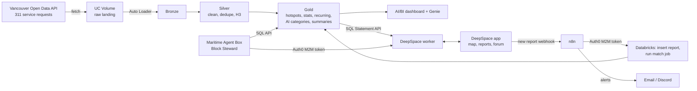

# Block by Block: Project Plan (HackCamp 2026)

A live map of Vancouver's 311 issues. Residents see what's broken near them, talk about it with neighbours, and send clean reports back to the City.

- Event: HackCamp 2026 by nwPlus, UBC Vancouver, **24 hours**
- Theme: identify a problem facing a community and build something that makes a meaningful difference
- Submission: GitHub repo, Figma link (needed for Best Design), demo video up to 4 minutes

---

## 1. Prize strategy

Ranked by how much the team wants each prize (lower total = more wanted), and what we do about it.

| Rank | Sponsor | What wins it | Our plan |
|---|---|---|---|
| 1 | Databricks | "Most creative and thoughtful" use of at least one Databricks product | **Core of the project.** Pipeline, AI functions, geospatial, dashboard, Genie, and serving all run on Databricks |
| 2 | Freebuff | Working project built with Freebuff, explain how it helped | Use Freebuff as the team's coding agent all weekend and keep a log (section 9) |
| 3 | Auth0 | Creative authentication and application security | Auth0 secures every machine-to-machine call (agent, n8n, pipeline) with scoped tokens, plus a moderator console with roles (section 7) |
| 4 | DeepSpace | Meaningful integration into real user flows, judged on product value, execution and use of DeepSpace | **The whole resident-facing app** is built and deployed on DeepSpace: map, reports, photo uploads, real-time neighbourhood forum |
| 5 | Maritime | An AI agent deployed on Maritime, with a short demo | **Block Steward agent** in a Maritime Agent Box: triages reports, posts weekly briefings, drafts 311 requests |
| 6 | Tailscale | Awarded through superlatives | Opt into **Community Impact** (impact statement) and **Best Design** (Figma link). nwChoice is automatic |
| 7 | ElevenLabs | Only through Overall Winner / Beginner Overall prize packages | Aim for Overall. Optional stretch: spoken neighbourhood briefings for accessibility |
| 8 | n8n | Creative n8n automation | n8n is the refeed bridge and alert system between the app and Databricks |
| 9+ | Gemini | MLH swag | Used as the agent's model since it's free. Opt in, no extra work |
| Drop | Solana, Vultr, Tiger Data, Entire, GoDaddy | | Not worth the time. Removing Vultr and Tiger Data also removes a server and a sync job we no longer need |

What changed from the previous plan and why:

- **DeepSpace replaces Next.js, FastAPI, Vultr, Caddy and Tiger Data.** It ships auth, a synced data layer, real-time messaging, file storage, scheduled jobs and one-command deploys to `<app>.app.space`. In 24 hours that's a big time saving, and it puts DeepSpace in every user flow, which is what their judging asks for.
- **Databricks now also serves the data and runs the AI.** The app reads gold tables through the Databricks SQL Statement API, and classification and summaries use Databricks AI Functions instead of calling Gemini from notebooks. More Databricks surface area, fewer network hops, and no outbound calls needed from inside Databricks for the AI step.
- **The "AI" part becomes a real agent on Maritime** instead of a batch script.
- **Google Maps is swapped for MapLibre** with free tiles. No prize attached, and it avoids setting up a Google Cloud billing account.
- **Auth0 moves to the service layer** because DeepSpace has its own sign-in for residents (Google and GitHub through its platform auth). Two resident logins would be confusing.

---

## 2. Architecture



In plain words:

- Databricks pulls 311 data, cleans it, tags every case with an H3 cell, classifies it with AI Functions and builds gold tables
- The DeepSpace app reads gold tables through the Databricks SQL API and shows the map and neighbourhood pages
- Residents sign in through DeepSpace, file reports with photos and talk in a real-time forum per neighbourhood
- n8n catches each new report, sends it into Databricks, triggers the matching job and fires alerts
- The Block Steward agent on Maritime wakes on a schedule or when a report comes in, checks Databricks for duplicates, drafts the 311 request and posts weekly briefings into the forum
- Every service-to-service call carries an Auth0 access token with specific scopes

---

## 3. Tech stack

| Layer | Choice |
|---|---|
| Data platform | Databricks trial workspace (express setup): Unity Catalog, Lakeflow Spark Declarative Pipelines, Lakeflow Jobs, Auto Loader, AI Functions, H3 functions, SQL warehouse, AI/BI dashboard, Genie |
| App | DeepSpace SDK: Vite + React frontend, Hono worker on Cloudflare Workers, records, messaging, file uploads, scheduled jobs, deploy to `blockbyblock.app.space` |
| Map | MapLibre GL JS with free OpenFreeMap tiles, deck.gl `H3HexagonLayer` via `@deck.gl/mapbox` interleaved overlay |
| Agent | Maritime Agent Box running a small Python agent, Gemini as the model |
| Automation | n8n Cloud (or self-hosted in the Maritime box if Cloud trial is an issue) |
| Service auth | Auth0 API with client-credentials (M2M) apps and scopes, Auth0 RBAC for the moderator console |
| Build tool | Freebuff CLI as the coding agent for everyone |
| Design | Figma for the Best Design submission |

---

## 4. Data source

City of Vancouver Open Data Portal (Opendatasoft):

- `3-1-1-service-requests`: 1.32M records from January 2022 onward, about 270k a year
- `3-1-1-service-requests-2009-2021`: historical; skip it this weekend unless everything else is done

Fields (confirmed, full profile in [docs/data-shape.md](docs/data-shape.md)):
`department`, `service_request_type`, `status`, `closure_reason`, `service_request_open_timestamp`, `service_request_close_date`, `last_modified_timestamp`, `address`, `local_area`, `channel`, `latitude`, `longitude`, `geom` (duplicate of lat/lon, drop it)

A sample, schema and profile are already in `data/sample/`. Run `python scripts/pull_311_sample.py --full` to get the full 48 MB parquet into `data/raw/` (gitignored) for the first load.

```
# Full export for the one-time load
https://opendata.vancouver.ca/api/explore/v2.1/catalog/datasets/3-1-1-service-requests/exports/parquet

# Incremental pulls
https://opendata.vancouver.ca/api/explore/v2.1/catalog/datasets/3-1-1-service-requests/exports/json?where=last_modified_timestamp>date'2026-11-01'
```

Notes:

- **Only 34% of rows have coordinates.** It depends on the request type: 109 of 256 types are geocoded, and big ones (building inquiries, missed bin pickups, parking enforcement, noise) never are. Those appear in area pages and tables, not on the map. 21% of rows have no `local_area` either.
- **There's no public case ID, and no natural key.** Even combining every column, about 1% of rows (mostly bulk-entered cases with no address) look identical. See 5.4 for how we handle it.
- **Timezones are mixed.** `service_request_open_timestamp` and `last_modified_timestamp` are UTC; `service_request_close_date` is a Vancouver local date. Convert before subtracting or 44k cases get negative resolution times.
- `status` is only `Open` or `Close`. `closure_reason` is never null (uses `N/A` / `Unknown`).
- Median resolution is 2 days, p90 16 days, p99 172 days.
- The portal refreshes daily (last processed 2026-11-07). A week of modifications is about 6.7k records. Pitch "live" as real-time resident reports plus daily City data.

---

## 5. Databricks deep dive

This is the prize we want most, so it gets the most care and the most visible demo time.

### 5.1 Workspace setup

- Databricks 14-day trial with **express setup**, signed up with a UBC email. Start it now; the event is inside the 14 days.
- One person owns the workspace and adds the others as users.
- First thing: run a network test notebook (`requests.get` against `opendata.vancouver.ca`). The trial limits external network access. If it fails, the fetch step moves to the Maritime agent box (section 5.3 fallback). The AI step no longer needs outbound access because it uses Databricks-hosted models.
- Create a secret scope `bbb` for anything sensitive.
- Create one service principal (or a personal access token for the weekend) that n8n, the agent and the DeepSpace worker use to call the SQL API. Store it as a secret in each of those, never in the repo.

### 5.2 Unity Catalog layout

```
catalog: bbb
├── raw
│   ├── volume: landing          # raw JSON/parquet from the API
│   └── watermark                # last modified timestamp pulled
├── bronze
│   └── t311_raw
├── silver
│   ├── t311_cases               # cleaned, typed, H3-tagged
│   ├── t311_cases_current       # latest version of each case (CDC)
│   └── resident_reports         # inserted by n8n from the app
└── gold
    ├── cases_enriched           # + AI category, resolution days
    ├── hotspots_h3              # open issues per H3 cell, last 90 days
    ├── area_weekly              # counts and median resolution per area
    ├── recurring_issues         # same type, same cell, many months
    ├── area_summaries           # AI-written weekly summary per area
    └── report_matches           # resident report -> likely existing case
```

```sql
CREATE CATALOG IF NOT EXISTS bbb;
CREATE SCHEMA IF NOT EXISTS bbb.raw;
CREATE SCHEMA IF NOT EXISTS bbb.bronze;
CREATE SCHEMA IF NOT EXISTS bbb.silver;
CREATE SCHEMA IF NOT EXISTS bbb.gold;
CREATE VOLUME IF NOT EXISTS bbb.raw.landing;
```

### 5.3 Ingestion task

Python notebook, first task in the job. Pulls only records modified since the last run.

```python
import requests, json, datetime as dt

BASE = "https://opendata.vancouver.ca/api/explore/v2.1/catalog/datasets/3-1-1-service-requests/exports/json"
LANDING = "/Volumes/bbb/raw/landing/311"

spark.sql("CREATE TABLE IF NOT EXISTS bbb.raw.watermark (source STRING, last_ts TIMESTAMP)")
since = spark.sql("SELECT max(last_ts) ts FROM bbb.raw.watermark WHERE source='311'").first().ts \
        or dt.datetime(2022, 1, 1)

resp = requests.get(BASE, params={"where": f"last_modified_timestamp > date'{since:%Y-%m-%d}'"}, timeout=120)
resp.raise_for_status()
records = resp.json()

if records:
    stamp = dt.datetime.utcnow().strftime("%Y%m%dT%H%M%S")
    dbutils.fs.put(f"{LANDING}/batch_{stamp}.json", "\n".join(json.dumps(r) for r in records), overwrite=True)
    newest = max(r["last_modified_timestamp"] for r in records)
    spark.sql(f"INSERT INTO bbb.raw.watermark VALUES ('311', timestamp'{newest}')")

dbutils.jobs.taskValues.set("landed", len(records))
```

For the first load, download the parquet export once and upload it to the volume through the UI or CLI.

**Fallback if Databricks can't reach the City API:** the Maritime agent box runs the same fetch on a schedule and uploads the file with the Databricks Files API (`PUT /api/2.0/fs/files/Volumes/bbb/raw/landing/311/<file>`). Everything downstream stays the same.

### 5.4 Pipeline: bronze, silver, gold

One Lakeflow Spark Declarative Pipeline, Python source. (`from pyspark import pipelines as dp` is the newer API; `import dlt` still works. Pick one.)

```python
from pyspark import pipelines as dp
from pyspark.sql import functions as F

# Bronze
@dp.table(name="bbb.bronze.t311_raw")
def t311_raw():
    return (spark.readStream.format("cloudFiles")
            .option("cloudFiles.format", "json")
            .option("cloudFiles.inferColumnTypes", "true")
            .load("/Volumes/bbb/raw/landing/311/")
            .withColumn("_ingested_at", F.current_timestamp())
            .withColumn("_source_file", F.col("_metadata.file_path")))

# Silver
@dp.table(name="bbb.silver.t311_cases")
@dp.expect_or_drop("has_open_time", "opened_at IS NOT NULL")
@dp.expect("has_location", "latitude IS NOT NULL AND longitude IS NOT NULL")
@dp.expect("in_vancouver", "latitude BETWEEN 49.19 AND 49.32 AND longitude BETWEEN -123.27 AND -123.02")
def t311_cases():
    df = (spark.readStream.table("bbb.bronze.t311_raw").select(
            "department",
            F.col("service_request_type").alias("request_type"),
            "status", "closure_reason",
            F.from_utc_timestamp(F.to_timestamp("service_request_open_timestamp"), "America/Vancouver").alias("opened_at"),
            F.to_date("service_request_close_date").alias("closed_on"),
            F.to_timestamp("last_modified_timestamp").alias("modified_at"),
            "address", "local_area", "channel",
            F.col("latitude").cast("double"), F.col("longitude").cast("double")))
    key_cols = ["department", "request_type", "opened_at", "address", "local_area", "channel", "latitude", "longitude"]
    return (df.withColumn("case_key", F.sha2(F.concat_ws("|", *key_cols), 256))
              .withColumn("h3_r9", F.expr("h3_longlatash3string(longitude, latitude, 9)")))

# Keep only the latest version of each case
dp.create_streaming_table("bbb.silver.t311_cases_current")
dp.create_auto_cdc_flow(
    target="bbb.silver.t311_cases_current",
    source="bbb.silver.t311_cases",
    keys=["case_key"],
    sequence_by=F.col("modified_at"),
    stored_as_scd_type=1,
)
```

If `create_auto_cdc_flow` isn't recognised, the older name is `apply_changes`.

Notes from the data pull:

- `opened_at` is stored in Vancouver local time so it lines up with `closed_on` (a local date) and with "this week" in summaries.
- `case_key` still collides on about 12.8k of 1.32M rows (1%), mostly bulk-entered cases with no address or coordinates, so CDC merges each group into one. That's acceptable: those rows mostly have no location and don't reach the map. If exact counts matter for the dashboard, compute them from `bbb.silver.t311_cases` (append-only) instead.
- The `in_vancouver` expectation passes on 99.999% of geocoded rows, so warn-only is right.

Gold views (SQL is fine here and easy to show on screen):

```sql
-- One AI call per distinct request type, not per row
CREATE OR REFRESH MATERIALIZED VIEW bbb.gold.type_categories AS
SELECT request_type,
       ai_classify(request_type, ARRAY(
         'Roads and Sidewalks','Garbage and Dumping','Graffiti','Noise','Parks and Trees',
         'Water and Sewer','Lighting and Signals','Parking','Animals','Other')) AS category
FROM (SELECT DISTINCT request_type FROM bbb.silver.t311_cases_current);

CREATE OR REFRESH MATERIALIZED VIEW bbb.gold.cases_enriched AS
SELECT c.*, t.category, datediff(c.closed_on, to_date(c.opened_at)) AS resolution_days
FROM bbb.silver.t311_cases_current c
LEFT JOIN bbb.gold.type_categories t USING (request_type);

CREATE OR REFRESH MATERIALIZED VIEW bbb.gold.hotspots_h3 AS
SELECT h3_r9, category, count(*) AS open_count
FROM bbb.gold.cases_enriched
WHERE status = 'Open' AND h3_r9 IS NOT NULL AND opened_at >= current_date() - INTERVAL 90 DAYS
GROUP BY h3_r9, category;

CREATE OR REFRESH MATERIALIZED VIEW bbb.gold.area_weekly AS
SELECT local_area, category, date_trunc('week', opened_at) AS week,
       count(*) AS opened, percentile_approx(resolution_days, 0.5) AS median_days
FROM bbb.gold.cases_enriched
GROUP BY ALL;

CREATE OR REFRESH MATERIALIZED VIEW bbb.gold.recurring_issues AS
SELECT h3_r9, request_type, count(*) AS times_reported,
       count(DISTINCT date_trunc('month', opened_at)) AS months_seen
FROM bbb.gold.cases_enriched
WHERE h3_r9 IS NOT NULL
GROUP BY ALL
HAVING months_seen >= 4;
```

`status` only takes `Open` and `Close` (checked), so the filters use `status = 'Open'`. `recurring_issues` also needs `h3_r9 IS NOT NULL`, or all the ungeocoded cases pile into one null cell.

### 5.5 AI Functions for summaries and report matching

All inside Databricks, using a pay-per-token foundation model endpoint (pick one listed on the Serving page of the workspace).

**Weekly neighbourhood summaries** (22 local areas means 22 calls):

```sql
CREATE OR REPLACE TABLE bbb.gold.area_summaries AS
SELECT local_area, current_date() AS generated_on,
       ai_query('<your-endpoint-name>',
         concat('Write 3 plain sentences for residents of ', local_area,
                ', Vancouver, about 311 issues this week. Name the biggest category, anything unusual, ',
                'and how fast the City is fixing things. No hype. Data: ', stats)) AS summary
FROM (
  SELECT local_area, to_json(collect_list(struct(category, opened, median_days))) AS stats
  FROM bbb.gold.area_weekly
  WHERE week >= date_trunc('week', current_date() - INTERVAL 7 DAYS)
  GROUP BY local_area
);
```

**Resident report classification and duplicate matching** (runs when n8n triggers the job):

```sql
CREATE OR REPLACE TEMP VIEW new_reports AS
SELECT r.*,
       ai_classify(r.description, ARRAY('Roads and Sidewalks','Garbage and Dumping','Graffiti','Noise',
         'Parks and Trees','Water and Sewer','Lighting and Signals','Parking','Animals','Other')) AS category,
       h3_longlatash3string(r.longitude, r.latitude, 9) AS h3_r9
FROM bbb.silver.resident_reports r
WHERE r.processed = false;

MERGE INTO bbb.gold.report_matches m
USING (
  SELECT n.report_id, n.category, n.h3_r9,
         max_by(c.case_key, c.opened_at) AS matched_case_key,
         max(c.opened_at) AS matched_opened_at
  FROM new_reports n
  LEFT JOIN bbb.gold.cases_enriched c
    ON c.category = n.category
   AND array_contains(h3_kring(n.h3_r9, 1), c.h3_r9)
   AND c.opened_at >= current_date() - INTERVAL 30 DAYS
   AND c.status = 'Open'
  GROUP BY n.report_id, n.category, n.h3_r9
) s ON m.report_id = s.report_id
WHEN NOT MATCHED THEN INSERT *;

UPDATE bbb.silver.resident_reports SET processed = true WHERE processed = false;
```

(`h3_kring` returns BIGINT cells; if the string version complains, compute `h3_r9` as BIGINT with `h3_longlatash3` throughout and convert to string only for the map.)

### 5.6 Serving the app straight from Databricks

The DeepSpace worker and the agent query gold tables with the SQL Statement Execution API. Hotspots and summaries are small, so the worker caches them in DeepSpace records with a scheduled job and the map loads instantly.

```ts
// DeepSpace worker: fetch hotspots from Databricks
const res = await fetch(`https://${env.DBX_HOST}/api/2.0/sql/statements`, {
  method: 'POST',
  headers: { Authorization: `Bearer ${env.DBX_TOKEN}`, 'Content-Type': 'application/json' },
  body: JSON.stringify({
    warehouse_id: env.DBX_WAREHOUSE_ID,
    statement: 'SELECT h3_r9, category, open_count FROM bbb.gold.hotspots_h3',
    wait_timeout: '30s',
    format: 'JSON_ARRAY',
    disposition: 'INLINE',
  }),
})
const { result } = await res.json()
```

Keep the SQL warehouse on a short auto-stop to save trial credits, and warm it up a few minutes before judging.

### 5.7 Orchestration

One Lakeflow Job:

```
fetch_311 ──► if landed > 0 ──► pipeline_refresh ──► area_summaries (Mondays or manual)
match_reports  (triggered by n8n through the Jobs API run-now endpoint)
```

Store the job and pipeline in a Databricks Asset Bundle (`databricks.yml`) in the repo so judges can see it's reproducible.

### 5.8 Demo surface for the Databricks judges

- Pipeline graph with expectation pass rates
- `ai_classify` turning a few hundred cryptic City request types into ten resident-friendly categories in one query
- H3 hotspots and `h3_kring` duplicate matching
- AI/BI dashboard: issues by area over time, slowest categories, top recurring hotspots
- Genie space over `bbb.gold`: ask "Which neighbourhood waits longest for graffiti removal?" live

---

## 6. DeepSpace app

Scaffold with `npm create deepspace@latest blockbyblock`, run locally with `npx deepspace dev start`, ship with `npx deepspace deploy`.

Pages:

- `/` Landing: one-line pitch and "Open the map"
- `/home` Map (public, no sign-in needed). Toggle pins and hexagons, category chips, neighbourhood picker. Only about a third of City cases have coordinates, so add a small "N more cases in this area aren't mapped" note to be honest about it
- `/area/:name` Neighbourhood page: weekly AI summary, trend chart, recurring issues, live forum channel
- `/report` (signed in) Drop a pin, describe the issue, add a photo. Shows "already reported" with the matched City case, or the agent's 311 draft with a copy button and a link to the City's reporting page
- `/moderate` Moderator console (Auth0, section 7)

DeepSpace pieces we use, so they show up clearly in the code and the write-up:

- **Auth**: resident sign-in with Google or GitHub, public map for signed-out visitors (`RecordProvider allowAnonymous`)
- **Records**: `reports`, `votes`, `hotspots_cache`, `area_summaries_cache` collections with role-based permissions (residents edit only their own reports)
- **Messaging**: one channel per local area for the forum; the agent posts weekly briefings there
- **File uploads**: report photos
- **Scheduled jobs**: refresh hotspot and summary caches from Databricks
- **Server actions**: webhook out to n8n when a report is created; inbound `/api/agent/*` routes for the agent

Read DeepSpace's design docs (they have a style tile and pattern library) before starting the UI. It helps with Best Design too.

---

## 7. Auth0: securing the service layer

Residents sign in through DeepSpace. Auth0 protects everything that isn't a resident in a browser, which is where most of the real risk in this system sits: an agent and an automation tool that can write into a civic data pipeline.

Setup:

- Auth0 API: `https://api.blockbyblock` with scopes `reports:triage`, `briefings:post`, `reports:ingest`, `moderation:write`
- M2M application **block-steward-agent**: scopes `reports:triage`, `briefings:post`
- M2M application **n8n-refeed**: scope `reports:ingest`
- Regular web application **moderator-console** with RBAC: role `moderator` gets `moderation:write`; require MFA for this role
- Auth0 Action on the M2M token flow that adds a custom claim with the caller name, so logs show which machine did what

Enforcement in the DeepSpace worker using its `verifyJwt` helper, pointed at Auth0's issuer and public key:

```ts
app.post('/api/agent/briefing', async (c) => {
  const token = (c.req.header('Authorization') ?? '').replace(/^Bearer\s+/i, '')
  const { result } = await verifyJwt({ publicKey: c.env.AUTH0_PUBLIC_KEY, issuer: c.env.AUTH0_ISSUER }, token)
  if (!result) return c.json({ error: 'unauthorized' }, 401)
  const scopes = String(result.claims.scope ?? '').split(' ')
  if (!scopes.includes('briefings:post')) return c.json({ error: 'forbidden' }, 403)
  // post briefing into the area's channel
})
```

What to say in the submission: least-privilege scopes per machine, short-lived tokens, MFA for humans with moderation power, and an audit trail of which agent wrote what.

**Ask the MLH or Auth0 mentor early** whether a service-layer integration plus the moderator console counts for "Best Use of Auth0". If they want resident login specifically, the fallback is to make the moderator console the main Auth0 showcase.

---

## 8. Maritime: the Block Steward agent

One Maritime **Agent Box** (persistent, sleeps when idle, wakes in about a second). Maritime's pitch is one agent per customer; ours is one steward per neighbourhood. For the demo, run one box and show it handling two areas.

What it does:

1. **Triage**: when n8n reports a new resident report, the agent wakes, reads the match result from `gold.report_matches`, and either links it to the existing City case or drafts a 311 request (category, location, plain description, suggested official request type). It posts the draft back to the app through `/api/agent/triage`.
2. **Weekly briefing**: on a schedule, reads `gold.area_summaries` and recurring issues, writes a friendly post, and publishes it to the area's forum channel.
3. **Fallback fetcher**: if Databricks can't reach the City API, it runs the 311 fetch and uploads files to the volume.

Stack inside the box: Python, `requests`, the Gemini SDK, a small loop or FastAPI endpoint that n8n calls. It gets an Auth0 token with client credentials and a Databricks token from its own secrets.

Human in the loop: the agent drafts, the resident sends. We never submit to the City on someone's behalf.

Stretch (only if everything else is done): use a Maritime Linux desktop to open the City's web form and pre-fill it for the resident to review.

Record a 30-second clip of the agent waking and posting a draft. Maritime requires a short demo in the submission.

---

## 9. n8n and Freebuff

**n8n workflows** (keep them visible and named well, judges will look at the canvas):

- *Report refeed*: DeepSpace webhook → get Auth0 token → insert row into `bbb.silver.resident_reports` via the SQL API → call Jobs API `run-now` for `match_reports` → wait → call the agent's triage endpoint
- *Hotspot alert*: daily → query new hotspots from Databricks → message a Discord channel or email subscribers for that area
- Optional: moderation queue, flagged posts go to a moderator by email

**Freebuff** (the judges want to hear how it helped):

- Everyone installs it at the start: `npm install -g freebuff`
- Use it for scaffolding (DeepSpace pages, n8n webhook handlers, agent loop) and for debugging
- One person keeps `FREEBUFF_LOG.md`: what we asked it, what it produced, time it saved, a couple of screenshots
- Mention it in the video and the Devpost write-up

---

## 10. Repo structure

```
block-by-block/
├── databricks/
│   ├── databricks.yml
│   ├── pipelines/t311_pipeline.py
│   ├── sql/gold_views.sql
│   ├── sql/ai_summaries.sql
│   ├── sql/match_reports.sql
│   └── notebooks/fetch_311.py
├── app/                       # DeepSpace project
├── agent/                     # Maritime Block Steward
├── n8n/                       # exported workflow JSON
├── scripts/pull_311_sample.py # pulls schema, sample and profile (--full for the parquet)
├── data/
│   ├── sample/                # committed: schema, 1-week sample, profile
│   └── raw/                   # gitignored: full parquet export
├── docs/
│   ├── data-shape.md          # field-by-field notes from the data pull
│   ├── FREEBUFF_LOG.md
│   ├── impact-statement.md
│   └── accessibility.md
└── README.md
```

---

## 11. Team split

| Person | Owns | Prizes they're carrying |
|---|---|---|
| P1 | Databricks: ingestion, pipeline, AI Functions, job, dashboard, Genie | Databricks |
| P2 | DeepSpace app: map, report flow, forum, deploy | DeepSpace, Best Design |
| P3 | Maritime agent and Auth0 | Maritime, Auth0, Gemini |
| P4 | n8n workflows, Figma, impact statement, Freebuff log, video and pitch | n8n, Freebuff, Community Impact |

Everyone uses Freebuff.

---

## 12. Timeline (24 hours)

**Hour 0 to 1**
- Databricks trial live, network test run, 311 parquet uploaded (run `scripts/pull_311_sample.py --full` to get it)
- DeepSpace app scaffolded and deployed once (empty) so deploys are proven
- Maritime box created, Auth0 tenant, API and M2M apps created
- n8n account ready, Freebuff installed on every laptop
- Opt into prizes on Devpost: Databricks, Freebuff, Auth0, DeepSpace, Maritime, n8n, Gemini, Community Impact, Best Design

**Hours 1 to 6: data and skeleton**
- P1: bronze, silver, `type_categories`, `hotspots_h3`
- P2: map with hexagons from a hard-coded sample, then from Databricks
- P3: agent skeleton calling Databricks SQL API; Auth0 token check working on one worker route
- P4: Figma wireframes for map, area page, report flow; n8n refeed workflow stub

**Hours 6 to 12: core loop**
- P1: remaining gold views, area summaries, match query, job wired
- P2: report flow with photo upload, area page with summary
- P3: triage flow end to end with Auth0 scopes
- P4: n8n refeed working against real endpoints

**Hours 12 to 16: community features** (sleep in shifts around here)
- P2: forum channels per area
- P3: weekly briefing posts into the forum
- P1: AI/BI dashboard and Genie space
- P4: hotspot alert workflow, impact statement draft

**Hours 16 to 20: polish**
- Design pass using the Figma, mobile layout, empty and error states
- Moderator console with Auth0 RBAC (cut if behind)
- Seed demo accounts and a few reports

**Hours 20 to 24: ship**
- Feature freeze at hour 20
- Record the demo video (under 4 minutes) and the 30-second Maritime clip
- Write the Devpost entry: problem statement, impact statement, how Freebuff helped, how each sponsor tool is used
- Final deploy, warm the SQL warehouse, rehearse

**Cut order if behind:** moderator console, hotspot alert, ElevenLabs, forum (keep briefings as a static card), weekly briefing agent task (keep triage).

---

## 13. Demo script (3 to 4 minutes)

1. **Problem (20 s)**: Vancouver logs a huge number of 311 requests every year and residents can't see any of it, or tell if their issue is already reported.
2. **Map (40 s)**: Open the map, flip to hotspots, open a neighbourhood and read the AI summary.
3. **Resident flow (60 s)**: Sign in, report overflowing garbage. The agent says it's already reported 3 days ago two blocks away. Report something new; the agent drafts the 311 request. Show the briefing in the forum.
4. **Under the hood (60 s)**: Databricks pipeline graph, `ai_classify` query, Genie answering a question live. Quick look at the n8n canvas and the Auth0 scopes.
5. **Impact and next steps (20 s)**: Fewer duplicate reports for the City, a voice for neighbourhoods, and the same Opendatasoft API covers other cities.

---

## 14. Risks

| Risk | Mitigation |
|---|---|
| Trial blocks Databricks from reaching the City API | Maritime box fetches and uploads to the volume |
| No pay-per-token model endpoint in the trial | Fall back to Gemini called from the agent for summaries and classification, results written back to Databricks |
| Too many sponsor integrations for 24 hours | Each person carries a clear set; strict cut order |
| Auth0 judges want resident login | Ask early; moderator console is the fallback showcase |
| SQL warehouse cold start during judging | Warm it before each judge; cache in DeepSpace records |
| Trial credits burn | Small warehouse, short auto-stop, develop on samples |
| Privacy | Never show withheld addresses; strip photo metadata on upload |

---

## 15. Open questions for the team

- Are we registered as a beginner team? If yes, also opt into Most Accessible Design and Best Problem-Solution Fit (more Tailscale chances)
- Does anyone already have n8n Cloud, or do we self-host it in the Maritime box?
- Who records the video, and when

---

## 16. Other additions if we have time

Only start these once the core loop (map, report flow, matching, agent triage) works end to end and is deployed. If more than one is possible, do them in this order.

### 16.1 Photo-based reporting (first pick)

A resident takes a photo of the problem and the report form fills itself in.

Why it's worth it:

- Residents don't have to know the City's request types; the photo does the categorising
- Gives the matching query a better category and description to work with
- Strong live demo moment, and helps Best Design, Community Impact and accessibility (people who struggle to write a description can still report)
- Gives the Gemini opt-in real usage

Flow:

1. Resident takes or uploads a photo on `/report`; the pin is filled from the photo's location or the phone's GPS
2. DeepSpace worker sends the image to Gemini and gets back JSON: category (one of our ten), one-line description, severity (low, medium, high), and whether the photo shows a public issue at all
3. The form shows the suggestion as editable fields; the resident confirms or changes it. Never save the AI's guess without confirmation
4. Report saves to DeepSpace as usual; n8n, Databricks matching and the agent take over unchanged

Why Gemini and not Databricks for this step: the resident is waiting on the form, so the answer needs to come back in a second or two. A Databricks job or a cold SQL warehouse is too slow for that.

How Databricks still benefits:

- Store `ai_category`, `ai_description` and `ai_severity` with the report in `bbb.silver.resident_reports`; the matching query uses `ai_category` when the resident didn't change it
- Optional extra: a nightly Databricks batch that re-checks the day's photos with a vision-capable model endpoint (if the trial has one) and flags reports where it disagrees with Gemini. A good talking point, not essential

Sketch of the worker call:

```ts
const prompt = `You are classifying a photo submitted to a city issue reporting app in Vancouver.
Return only JSON: {"is_public_issue": boolean, "category": one of ${JSON.stringify(CATEGORIES)},
"description": "one plain sentence", "severity": "low" | "medium" | "high"}`

const res = await fetch(
  `https://generativelanguage.googleapis.com/v1beta/models/${env.GEMINI_MODEL}:generateContent?key=${env.GEMINI_API_KEY}`,
  {
    method: 'POST',
    headers: { 'Content-Type': 'application/json' },
    body: JSON.stringify({
      contents: [{ parts: [
        { text: prompt },
        { inline_data: { mime_type: file.type, data: base64Image } },
      ] }],
      generationConfig: { responseMimeType: 'application/json' },
    }),
  })
```

Handle:

- **Privacy**: read the location first, then strip metadata before storing the photo. Tell people not to photograph faces or licence plates; blur them if there's time
- **Junk photos**: if `is_public_issue` is false, ask the resident to retake
- **Wrong guesses**: always editable, never auto-submitted
- **Bad JSON**: validate, retry once, then fall back to the manual form

Owner and effort: P3, about 2 to 3 hours, since the report form already exists.

### 16.2 Smaller extras (after 16.1)

- **Spoken neighbourhood briefings**: ElevenLabs reads the weekly summary aloud on the area page. Accessibility angle, about an hour
- **Maritime desktop pre-fill**: the agent opens the City's web form in a Maritime Linux desktop and pre-fills it for the resident to review and send themselves
- **Nightly photo re-check in Databricks** (see 16.1)