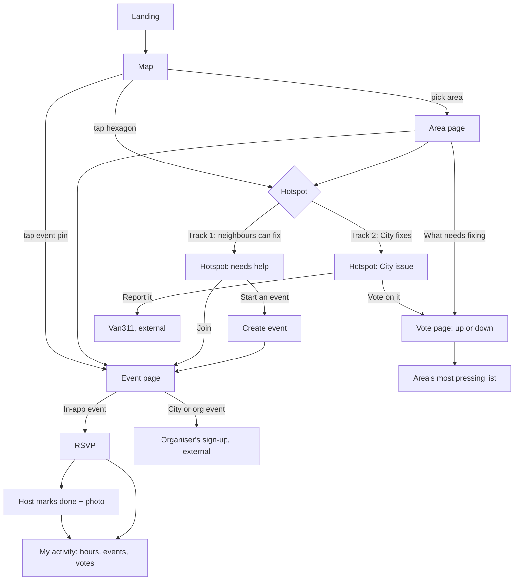
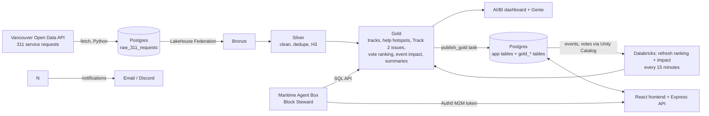

# Block by Block: Project Plan (HackCamp 2026)

Block by Block turns what's broken on your block into ways to help. A map built on Vancouver's 311 data shows where neighbourhoods need help, connects residents with City and local organisation volunteer events (or lets them start one from a hotspot), and lets neighbours vote on the fixes only the City can make.

- Event: HackCamp 2026 by nwPlus, UBC Vancouver, **24 hours**
- Theme: identify a problem facing a community and build something that makes a meaningful difference
- Submission: GitHub repo, Figma link (needed for Best Design), demo video up to 4 minutes

---

## 0. Product direction (updated 2026-11-07)

This section replaces the original "report it and check for duplicates" idea as the core. Sections 1 to 16 have been updated to match it.

### Why we changed

The City already has **Van311** (formerly VanConnect): residents report potholes, graffiti and lights with a photo and GPS pin, and see a map of current service issues. A reporting app would mostly duplicate it.

### Issues create events: least crowded, and the City already has the programs

- The City runs volunteer programs that fit this exactly:
  - [Neighbourhood Cleanup Party](https://vancouver.ca/people-programs/neighbourhood-cleanup-party.aspx): the City lends supplies for a one-time cleanup
  - [Adopt a Block](https://vancouver.ca/people-programs/adopt-a-block-program.aspx): you pledge to keep a block clean for a year
  - [Adopt a Catch Basin](https://vancouver.ca/people-programs/adopt-a-catch-basin.aspx): an online map of more than 32,000 drains. Downtown, Mount Pleasant and Kitsilano need the most help. The City marked the program's 10th anniversary on 2026-11-05

  Each program has its own separate form, and none of them is driven by 311 data.
- Closest apps elsewhere:
  - [Clean LA Volunteers](https://sites.epss.ucla.edu/omar/?p=161) matches cleanup reports with volunteers, and lists event scheduling only as a future feature
  - [Keep the Earth Fresh](https://amp.cbc.ca/news/canada/calgary/keep-the-earth-fresh-app-1.6844561) in Calgary builds a litter heat map to decide where to hold cleanup days
  - TrashMob talked about turning a reported spot into an event in one tap, but it was only a planned feature
- **The gap:** nobody automatically turns real City issue data into a neighbourhood event that's linked to the City's own programs.

### What we build: two tracks, split by who can fix it

Every issue on the map falls into one of two tracks.

**Track 1: neighbours can fix it, so it becomes a volunteer opportunity.** This is the main gap and the core of the app.

- Covers litter, illegal dumping, graffiti on private fences, clogged catch basins, overgrown paths, and leaves on drains before the rains
- 311 hotspots show where help is needed. A recurring issue ("graffiti reported 9 times in 6 months on this block") is the strongest signal
- **We connect local organisations to people.** A local org (a community centre, BIA, school club, community garden or church group) or a resident turns a hotspot into a volunteer opportunity: what, where, when, how many people. Residents browse opportunities near them and sign up
- Opportunities link to the City programs above: request cleanup supplies, adopt the block, or adopt the drains near the event
- After the event, the host marks it done with a photo, and the map shows the before and after. Volunteers build a record of hours, which helps students who need volunteer hours (Adopt a Block already counts for school hours)

**Track 2: only the City can fix it, so neighbours vote on it.** Potholes, broken streetlights, damaged sidewalks, water main issues. Voting lives on its own page, separate from volunteering.

- Residents can't fix these, so we don't try. Instead, each issue gets an **up vote** ("this affects me, it's pressing") or a **down vote** ("not a problem, already fixed, or not urgent")
- One vote per resident per issue (can be changed), counted by neighbourhood and H3 cell
- A "most pressing" ranking per area combines net votes with what the City data already tells us: how long it's been open, how often it recurs, and whether it's on a bus or bike route (pavement ratings dataset)
- Being honest about the limit: the City doesn't read our votes today. What we produce is a clear, shareable priority list per neighbourhood that residents can send to the City or to Council (prefilled email, sent by the resident), plus a link to report it properly in Van311

### Where local organisations come from

Seed them from open data so the app isn't empty on day one, then let orgs claim their profile:

- `community-centres` (27)
- `business-improvement-areas-bia` (24)
- `community-gardens-and-food-trees` (170, has `steward_or_managing_organization` and a public email)
- `free-and-low-cost-food-programs` (77, has `organization_name`)
- `schools` (194), `libraries` (22)

### Existing volunteer events from the City and local orgs

Not every opportunity has to start from a hotspot. The app also lists volunteer events that the City and local organisations already run, so residents get one place to find ways to help near them. Each listing links out to the organiser's own sign-up. We don't take sign-ups for other people's events.

| Source | What's there | How we get it |
|---|---|---|
| [City Neighbourhood Cleanup Programs](https://app.betterimpact.com/PublicOrganization/c6e38574-b5fa-4920-9679-a5ec7c8dd23c/3) (Better Impact) | **City Hosted Cleanups**, plus sign-up for Cleanup Party and Adopt a Block | No public feed: the list of dates sits behind a volunteer login. Enter the upcoming dates by hand and link to the page |
| [Park Board Park Stewards](https://vancouver.ca/files/cov/become-a-park-steward.pdf) | Ongoing park stewardship: invasive plant removal and planting. The Park Board gives training, tools and plants | Static entry per park group, contact `parkstewards@vancouver.ca` |
| [Adopt a Catch Basin](https://vancouver.ca/people-programs/adopt-a-catch-basin.aspx) | Drain adoption, most needed in Downtown, Mount Pleasant and Kitsilano | Link out, and show it on Track 1 drain hotspots (`sewer-catch-basins` dataset) |
| Stanley Park Ecology Society and similar groups | Invasive plant pulls, wildlife monitoring, events | Hand-entered, or the org posts in the app |
| Volunteer BC's Volunteer Now, [Volunteer Connector](https://govolunteer.ca) (GoVolunteer.ca now points there), [Idealist Vancouver](https://www.idealist.org/en/volunteer-in-vancouver?page=3) | Hundreds of listings from Vancouver nonprofits (food rescue, youth literacy, mentoring) | Link out from the area page. Check terms before pulling anything automatically |
| Local orgs in the app (community centres, BIAs, gardens, food programs) | Their own events | Posted directly in the app through their org profile |

For the hackathon:

- Hand-curate 20 to 30 real, upcoming listings into a seed file (`data/seed/volunteer_events.json`; a 7-event example with the exact shape is in `data/seed/volunteer_events.sample.json`) with title, organiser, date, location, local area, category, and sign-up URL. Put them in two or three neighbourhoods to demo
- Tag each listing with the same categories as the 311 issues (`ai_classify` in Databricks, or by hand), so the area page can say "3 cleanups and 1 drain adoption drive near the dumping hotspot on Commercial Drive"
- One event list per area that mixes three kinds, each with a clear label: **City event**, **Local org event**, **Started from a hotspot** (Track 1)
- Don't scrape anything behind a login, and don't copy listings from Idealist or Volunteer Connector wholesale

### UI flow

Browsing is public. Signing in (Auth0) is needed only to RSVP, vote, create an event or claim an org.



**Screens**

| Screen | Route | What's on it | Main actions |
|---|---|---|---|
| Landing | `/` | One-line pitch: "Turn what's broken on your block into ways to help" | Open the map |
| Map | `/map` | H3 hexagons coloured by track (Track 1 in one colour, Track 2 in another), event pins, area outlines. Filter chips: category, track, this week. List view toggle for mobile and accessibility | Tap a hexagon, an event pin or an area |
| Area page | `/area/:name` | Weekly summary. **Ways to help this week**: volunteer cards mixing the three labels (City event, Local org event, Started from a hotspot). **Needs help**: top Track 1 hotspots. A small "What needs fixing" teaser with the top 3 Track 2 issues, linking to the vote page. Local orgs in the area | Join an event, open a hotspot, go to the vote page |
| Hotspot, Track 1 | `/hotspot/:id` | What's been reported, how often, since when ("Dumping reported 9 times in 6 months"). Events already planned nearby. Matching City program (Cleanup Party, Adopt a Block, Adopt a Catch Basin) | **Join** an existing event, or **Start an event** |
| Hotspot, Track 2 | `/hotspot/:id` | Same history. Current score and rank in the area. Note that only the City can fix this | **Vote on it** (opens the vote page at this issue), **Report in Van311** |
| Vote page | `/area/:name/fix` | Its own page, separate from volunteering. All Track 2 issues in the area as a list, each with an **up** and **down** vote. Up = "this affects me, it's pressing". Down = "not a problem / already fixed / not urgent". Sorted by score (net votes, plus age, recurrence and bus or bike route). Shows how many residents voted | Vote up or down (one vote per person per issue, can change it), "Send this list to Council", report in Van311 |
| Create event | `/events/new?hotspot=:id` | Form prefilled from the hotspot: title, location, category. Organiser picks date, time, spots, and whether they post as themselves or as an org. Link to request City cleanup supplies | Publish |
| Event page | `/events/:id` | What, where, when, organiser, spots left, what to bring, before photo. Comment thread for attendees. External events show a clear "Sign up on [organiser]'s site" button instead of RSVP | RSVP or sign up externally, share |
| Event done | `/events/:id/done` | Host only: after photo, number of people, bags collected | Mark done. The hotspot shows before and after on the map |
| Org profile | `/org/:id` | Seeded from open data. Upcoming events, areas served, contact. Org admins also see the agent's event suggestions | Claim this org (a moderator approves it), post an event, accept a suggestion |
| My activity | `/me` | Upcoming RSVPs, past events, volunteer hours, votes | Download a volunteer hours record (useful for students) |

**Key flows to demo** (in this order, about 90 seconds)

1. **Find a way to help**: open the map, pick Mount Pleasant, see "Ways to help this week", join a City Hosted Cleanup (goes to the City's sign-up page)
2. **Turn a hotspot into an event**: tap a recurring dumping hotspot, see the 6-month history, tap Start an event, the form is prefilled, publish. It now shows on the map and area page
3. **Vote on what the City should fix**: open the area's vote page, upvote a pothole and downvote one that's already been fixed, see the list re-sort, open "Send this list to Council"
4. **Close the loop**: switch to the host account, mark the event done with an after photo, and the hotspot shows before and after

**Volunteer card** (the building block of the area page, the map's list view and My activity)

Every volunteer opportunity, whoever runs it, uses the same card. Top to bottom:

1. **Badges**: who runs it (`City event`, `Local org event`, `Started from a hotspot`, each its own colour) and the category chip in the Track 1 colour. A small `Sample` tag while a listing isn't confirmed with the organiser
2. **Title** and **organiser**
3. **When** ("Sat, Nov 15 · 10:00am–12:00pm") and **where** (location · local area)
4. **Why here** (only when tied to a hotspot): "Illegal dumping reported 9 times in 6 months on this block", taken from `gold.recurring_issues`. This line is what makes it different from any other volunteer listing
5. **What to bring / what's provided** (one line, optional)
6. **Spots** (in-app events only): "7 of 12 going" with a progress bar, "5 spots left" or "Full"
7. **Action**, one button only:
   - In-app event: **I'm in** → becomes "You're going ✓" (tap again to cancel). Disabled as "Event is full" when full. Needs sign-in
   - City or org event: **Sign up on vancouver.ca ↗** with "Opens the organiser's site" underneath. We never take sign-ups for someone else's event

Card data fields (match the seed file): `id, kind (city | org | hotspot), title, organiser, category, startsAt, endsAt, location, localArea, spotsTotal?, spotsTaken?, whatToBring?, signupUrl? (external events only), hotspot? {requestType, timesReported, monthsSeen}, sample`

The list around the cards ("Ways to help this week"): sorted by date, an area picker, filter chips `All / City event / Local org event / Started from a hotspot`, one column on phones and up to three on desktop. Empty state: "Nothing planned here yet. Start an event from a hotspot on the map."

**Vote page** (`/area/:name/fix`, separate from volunteering)

- Header: "What needs fixing in Mount Pleasant", with one line saying only the City can fix these, and how many residents have voted
- One row per Track 2 issue: issue type and location, how long it's been open, times reported, a "bus route" or "bike route" tag if it applies, the score, and **▲ / ▼** buttons with the person's current vote highlighted
- Sorted by score. The list re-sorts as votes come in
- Under each row: **Report in Van311 ↗**
- Footer: **Send this list to Council**, which opens a prefilled email the resident sends themselves (top 5 issues, with links)

**Design notes**

- Two track colours used everywhere (map, chips, cards) so residents always know whether something is "you can help" or "the City has to fix it"
- Labels on every event card say who runs it, and external events always say they leave the app
- Mobile first, since people will open it on the street. Large tap targets and a list view as an alternative to the map

### Pitch: how we sell it

**One line:** Block by Block turns what's broken on your block into ways to help.

**30-second version:**
> Vancouver logs more than a quarter of a million 311 requests a year, and the same problems keep coming back to the same blocks: dumping, litter, clogged drains. Residents report them and wait. Meanwhile the City runs volunteer cleanup programs, and local groups are looking for volunteers, but it's all on separate forms and websites, and none of it points at where help is actually needed. Block by Block puts it on one map. It shows where the City's own data says your neighbourhood needs help, the volunteer events already happening nearby, and a one-tap way to start one. For the things only the City can fix, neighbours vote on what matters most and send that list to Council.

**The problem, in three beats**

1. **The same issues keep coming back.** 311 tells the City something is broken, and it gets cleared, but nobody tackles the pattern. (Before the pitch: pull the real number from `gold.recurring_issues`, for example "X blocks had dumping reported in 4 or more separate months".)
2. **People want to help but don't know where.** City programs (Cleanup Party, Adopt a Block, Adopt a Catch Basin), Park Stewards, and nonprofits each have their own sign-up. None of them is matched to where the problems are.
3. **Residents have no say in what gets fixed first.** Van311 is a one-way pipe: you report, you wait.

**What we do: three things, one map**

- **See** where help is needed, from real City data (311 hotspots and recurring issues, processed in Databricks)
- **Help**: join a City or local org volunteer event nearby, or turn a hotspot into a new one in one tap. Local organisations get volunteers exactly where they're needed
- **Speak up**: for City-only fixes, vote up or down on what's most pressing and send the list to Council

**Why not just use…**

| Existing tool | What it does | What we add |
|---|---|---|
| Van311 | Report an issue to the City | We don't replace it, we link to it. We act on the patterns 311 already shows |
| City cleanup programs | Separate sign-up forms | One place to find them, placed where the data says they're needed |
| Volunteer BC, Idealist, Eventbrite | General volunteer listings | Hyperlocal, tied to real problems on your block, with before and after |
| Nextdoor | Neighbours complaining | Neighbours doing something about it |

**Who it's for**

- **Residents**, especially students who need volunteer hours, newcomers who want to meet neighbours, and people who are tired of reporting the same thing
- **Local organisations** (community centres, BIAs, gardens, school clubs) who need volunteers and a reason to show up
- **The City**, which gets fewer repeat reports and a clear signal of what neighbourhoods care about

**The impact story (our strongest point)**

We can measure whether it works. Because every event is tied to a hotspot, Databricks can compare 311 reports on that block before and after a cleanup. "Dumping reports on this block dropped from 6 a month to 1 after two cleanups" is the kind of line that wins Community Impact. For the demo, show the method on real data and be clear that results need time.

**One line per judge**

- **Databricks:** "1.3M City records go through a Databricks pipeline that finds recurring hotspots, sorts every request type into 'neighbours can fix' or 'City fixes' with AI Functions, and measures before and after"
- **Auth0:** "Residents, organisations and moderators sign in with different roles. Only an org admin can post as an org"
- **Community Impact:** "We turn complaints into volunteer hours, and we can show whether it worked"
- **Best Design:** "Two colours tell you at a glance: you can help with this, or the City has to fix it"

**What we never claim**

- That the City reads our votes, or that we partner with the City or any org. Say "built on City open data and City volunteer programs"
- Sample volunteer events in the demo are marked as samples unless we've confirmed them

### What changes in the rest of the plan

- **Core loop becomes:** see hotspots → (Track 1) create or join a volunteer opportunity, or find an existing City or local org event nearby → mark done; (Track 2, own page) vote up or down → priority list per area
- **Drop from core:** filing new reports and duplicate matching. Van311 already does this. A "report in Van311" link replaces it
- **Databricks still carries the data:** 311 hotspots and recurring issues decide what to show, `ai_classify` sorts each request type into Track 1 or Track 2, and a gold table ranks "most pressing" per area from net votes, age and recurrence
- **App (Next.js + Postgres):** opportunities, sign-ups, votes, org profiles, and a comment thread per event as the event chat
- **Maritime agent (optional):** suggests opportunities from recurring hotspots and nudges nearby orgs ("Your area has 4 recurring dumping spots near Trout Lake. Host a cleanup?")

---

## 1. Prize strategy

Ranked by how much the team wants each prize (lower total = more wanted), and what we do about it.

| Rank | Sponsor | What wins it | Our plan |
|---|---|---|---|
| 1 | Databricks | "Most creative and thoughtful" use of at least one Databricks product | **Core of the project.** Pipeline, AI Functions (sorting request types into the two tracks), H3 hotspots, vote ranking, before and after impact, dashboard and Genie all run on Databricks, reading our Postgres through Lakehouse Federation |
| 2 | Freebuff | Working project built with Freebuff, explain how it helped | Use Freebuff as the team's coding agent all weekend and keep a log (section 9) |
| 3 | Auth0 | Creative authentication and application security | Auth0 does resident sign-in, **roles** (resident, org admin, moderator: only an org admin can post as an org), and secures every machine-to-machine call (the agent) with scoped tokens (section 7) |
| 4 | Maritime | An AI agent deployed on Maritime, with a short demo | **Block Steward agent** in a Maritime Agent Box: spots recurring hotspots with nothing planned, suggests events to nearby orgs, posts weekly "ways to help" briefings |
| 5 | Tailscale | Awarded through superlatives | Opt into **Community Impact** (impact statement) and **Best Design** (Figma link). nwChoice is automatic |
| 6 | ElevenLabs | Only through Overall Winner / Beginner Overall prize packages | Aim for Overall. Optional stretch: spoken neighbourhood briefings for accessibility |
| 8+ | Gemini | MLH swag | Used as the agent's model since it's free. Opt in, no extra work |
| Drop | Solana, Vultr, Tiger Data, Entire, GoDaddy | | Not worth the time |

What changed from the previous plan and why:

- **The app is a plain Next.js project on Vercel** (pages and API routes in one codebase, one-command deploy). Everyone already knows the stack and there's no platform SDK to learn mid-hackathon.
- **Postgres is the buffer on both sides of Databricks.** We use **our own Postgres**, which is already running outside Databricks. **All input lands in Postgres first**: the City's 311 data (initial load and daily fetch) and everything the app creates (events, RSVPs, votes, orgs, comments). Databricks reads it through **Lakehouse Federation** (a Unity Catalog foreign catalog, no copy job), and a `publish_gold` job task writes the clean gold tables back into Postgres as `gold_*` tables. The app only ever talks to Postgres, which is fast and has no SQL warehouse cold start.
- **Databricks runs the AI.** Classification and summaries use Databricks AI Functions instead of calling Gemini from notebooks. No outbound calls needed from inside Databricks for the AI step.
- **The "AI" part becomes a real agent on Maritime** instead of a batch script.
- **Google Maps is swapped for MapLibre** with free tiles. No prize attached, and it avoids setting up a Google Cloud billing account.
- **Auth0 handles resident sign-in too**, since there's no platform login any more. One login for residents (Google or email), plus an M2M token for the agent.

---

## 2. Architecture



In plain words:

- A small Python fetch writes the City's 311 data into Postgres (`raw_311_requests`). Databricks reads it from there, cleans it, tags every case with an H3 cell, and uses AI Functions to sort every request type into a category and a track: neighbours can help (Track 1) or the City must fix it (Track 2)
- Gold tables find recurring Track 1 hotspots, group open Track 2 cases into issues people can vote on, rank them, and measure 311 reports before and after each event
- Gold tables are copied back into Postgres (`gold_*` tables) at the end of each job run. The Next.js app reads them from Postgres for the map, area pages and vote page
- Residents sign in with Auth0. Everything they create (events, RSVPs, votes, comments, photos) is written to Postgres, and Databricks reads it back through Unity Catalog
- Databricks refreshes app vote rankings and event impact every 15 minutes. All scheduled work runs as Databricks jobs
- The Block Steward agent on Maritime looks for recurring hotspots with nothing planned, suggests events to nearby orgs, and posts weekly "ways to help" briefings on area pages
- Every service-to-service call carries an Auth0 access token with specific scopes

---

## 3. Tech stack

| Layer | Choice |
|---|---|
| Data platform | Databricks trial workspace (express setup): Unity Catalog, Lakehouse Federation (Postgres), Lakeflow Spark Declarative Pipelines, Lakeflow Jobs, AI Functions, H3 functions, SQL warehouse, AI/BI dashboard, Genie |
| App | Next.js (App Router, TypeScript): pages and API routes in one project, deployed to Vercel with `vercel deploy` |
| Database | Our own Postgres (already running, outside Databricks): raw 311 table, app tables and `gold_*` tables. Accessed from Next.js with the `postgres` (postgres.js) driver, from Python with `psycopg`, and from Databricks through a Lakehouse Federation foreign catalog |
| Resident sign-in | Auth0 Universal Login (Google and email) with `@auth0/nextjs-auth0` |
| Photo storage | Vercel Blob (free tier), URL stored in Postgres |
| Map | MapLibre GL JS with free OpenFreeMap tiles, deck.gl `H3HexagonLayer` via `@deck.gl/mapbox` interleaved overlay |
| Agent | Maritime Agent Box running a small Python agent, Gemini as the model |
| Automation | Databricks Jobs for everything scheduled (daily ingest and pipeline, 15-minute ranking/impact refresh). No n8n |
| Service auth | Auth0 API with client-credentials (M2M) apps and scopes, Auth0 RBAC roles for org admins and moderators |
| Build tool | Freebuff CLI as the coding agent for everyone |
| Design | Figma for the Best Design submission |

### 3.1 Data flow and languages

```
City 311 API ──Python──► Postgres raw_311_requests ─┐
App (events, RSVPs, votes…) ──TypeScript──► Postgres app tables ─┤
                                                                 ▼
                              Databricks pipeline (Python + SQL): bronze → silver → gold
                                                                 │ publish_gold task (Python)
                                                                 ▼
                              Postgres gold_* tables ──TypeScript──► Next.js app
```

Postgres is the only thing the app touches, and the only place input lands. Databricks sits in the middle and does the cleaning, H3, AI and ranking.

| Part | Language | Notes |
|---|---|---|
| Next.js pages and API routes | **TypeScript** | Reads and writes Postgres with postgres.js |
| 311 fetch (initial load and daily) | **Python** | `psycopg` `COPY` into `raw_311_requests` (section 5.3) |
| Databricks pipeline | **Python** (bronze, silver) + **SQL** (gold) | Already built in `databricks/`; bronze switches to reading Postgres (section 5.4) |
| Postgres tables | **SQL** | Migrations in `app/db/migrations/` |
| Maritime agent | **Python** | |

Three languages, and SQL is shared by everyone. Don't add a fourth.

---

## 4. Data source

City of Vancouver Open Data Portal (Opendatasoft):

- `3-1-1-service-requests`: 1.32M records from January 2022 onward, about 270k a year
- `3-1-1-service-requests-2009-2021`: historical; skip it this weekend unless everything else is done

Fields (confirmed, full profile in [docs/data-shape.md](docs/data-shape.md)):
`department`, `service_request_type`, `status`, `closure_reason`, `service_request_open_timestamp`, `service_request_close_date`, `last_modified_timestamp`, `address`, `local_area`, `channel`, `latitude`, `longitude`, `geom` (duplicate of lat/lon, drop it)

A sample, schema and profile are already in `data/sample/`. Run `python scripts/pull_311_sample.py --full` to get the full 48 MB parquet into `data/raw/` (gitignored), then `python scripts/load_311_to_postgres.py data/raw/3-1-1-service-requests.parquet` to load all 1.32M rows into Postgres for the first load (a `COPY`, about a minute).

```
# Full export for the one-time load
https://opendata.vancouver.ca/api/explore/v2.1/catalog/datasets/3-1-1-service-requests/exports/parquet

# Incremental pulls
https://opendata.vancouver.ca/api/explore/v2.1/catalog/datasets/3-1-1-service-requests/exports/json?where=last_modified_timestamp>date'2026-11-01'
```

Notes:

- **Only 34% of rows have coordinates.** It depends on the request type: 109 of 256 types are geocoded, and big ones (building inquiries, missed bin pickups, parking enforcement, noise) never are. Those appear in area pages and tables, not on the map. 21% of rows have no `local_area` either.
- **There's no public case ID, and no natural key.** Even combining every column, about 1% of rows (mostly bulk-entered cases with no address) look identical. See 5.4 for how we handle it.
- **Timezones are mixed.** `service_request_open_timestamp` and `last_modified_timestamp` are UTC; `service_request_close_date` is a Vancouver local date. Convert before subtracting or 44k cases get negative resolution times.
- `status` is only `Open` or `Close`. `closure_reason` is never null (uses `N/A` / `Unknown`).
- Median resolution is 2 days, p90 16 days, p99 172 days.
- The portal refreshes daily (last processed 2026-11-07). A week of modifications is about 6.7k records. Pitch "live" as real-time resident reports plus daily City data.

---

## 5. Databricks deep dive

This is the prize we want most, so it gets the most care and the most visible demo time.

### 5.1 Workspace setup

- Databricks 14-day trial with **express setup**, signed up with a UBC email. Start it now; the event is inside the 14 days.
- One person owns the workspace and adds the others as users.
- First thing: run a network test notebook (`requests.get` against `opendata.vancouver.ca`). The trial limits external network access. (Done 2026-11-07: it works, so the fetch runs as a Databricks job task. If it ever fails, the same fetch script runs in the Maritime agent box, since it only needs to reach the City API and Postgres.) The AI step no longer needs outbound access because it uses Databricks-hosted models.
- Create a secret scope `bbb` for anything sensitive.
- Create one service principal (or a personal access token for the weekend) that the agent uses to call the SQL and Jobs APIs. Store it as a secret in each of those, never in the repo. The app doesn't need it: it only talks to Postgres.
- Connect **our existing Postgres**: database `hackcamp` on `db-hackcamp.noodlelab.ca:5433`, user `hackcamp`. The connection details live in the repo-root `env` file (gitignored; `env.example` is the committed template with the connection steps). It must be reachable from Databricks serverless over the internet. If it has an IP allowlist, allow Databricks' outbound IPs.
- **Open issue (2026-11-07):** the server rejects SSL (`server does not support SSL`), so `sslmode=require` fails. Turn SSL on before Databricks connects over the internet; otherwise the password and data travel in plain text.
- For the weekend everything uses the one `hackcamp` user. If there's time, split it into `bbb_app` (Next.js), `bbb_ingest` (311 fetch, `publish_gold`) and a read-only `bbb_reader` for Lakehouse Federation.
- **Done in code:** `python databricks/setup/setup_postgres.py` reads `env`, stores `pg_host`, `pg_port`, `pg_db`, `pg_user`, `pg_password` and `pg_sslmode` in the `bbb` secret scope (sent on stdin, never printed), then runs `databricks/sql/setup.sql` on the SQL warehouse. That file creates the connection, the foreign catalog `bbb_app` and the `bbb.gold.track_overrides` table:
- Register it in Unity Catalog as foreign catalog `bbb_app`, so the pipeline can read the raw 311 table and the app's tables:

```sql
CREATE CONNECTION bbb_pg TYPE postgresql
OPTIONS (host '<pg-host>', port '5433', user secret('bbb', 'pg_user'), password secret('bbb', 'pg_password'));

CREATE FOREIGN CATALOG bbb_app USING CONNECTION bbb_pg OPTIONS (database 'hackcamp');
```

### 5.2 Unity Catalog layout

```
catalog: bbb
├── raw
│   └── volume: landing          # not used any more: all input lands in Postgres
├── bronze
│   └── t311_raw                 # copy of bbb_app.public.raw_311_requests
├── silver
│   ├── t311_cases               # cleaned, typed, H3-tagged
│   └── t311_cases_current       # latest version of each case (CDC)
└── gold
    ├── type_categories          # AI category + track for each request type
    ├── cases_enriched           # + category, track, resolution days
    ├── hotspots_h3              # open issues per H3 cell and track, last 90 days (map)
    ├── area_weekly              # counts and median resolution per area
    ├── recurring_issues         # same type, same cell, many months
    ├── help_hotspots            # Track 1: recurring spots neighbours can help with
    ├── track2_issues            # Track 2: open City-only issues people vote on, with a base score
    ├── issue_priority           # Track 2 issues + votes, ranked per area (Genie, dashboard, Council list)
    ├── event_impact             # 311 reports near each event, before vs after
    └── area_summaries           # AI-written weekly summary per area
```

```sql
CREATE CATALOG IF NOT EXISTS bbb;
CREATE SCHEMA IF NOT EXISTS bbb.raw;
CREATE SCHEMA IF NOT EXISTS bbb.bronze;
CREATE SCHEMA IF NOT EXISTS bbb.silver;
CREATE SCHEMA IF NOT EXISTS bbb.gold;
CREATE VOLUME IF NOT EXISTS bbb.raw.landing;
```

```
catalog: bbb_app                 # our Postgres, as a Lakehouse Federation foreign catalog (read-only)
└── public
    ├── raw_311_requests         # every 311 row as fetched (append-only)
    ├── events, rsvps, votes, orgs, org_members, comments, posts   # written by the app
    └── gold_*                   # copies of bbb.gold tables, written by publish_gold
```

```sql
-- Postgres: app/db/migrations/001_ingest.sql (TypeScript ingest, docs/ingest.md). Columns Databricks reads:
raw_311_requests (
  ingest_id bigserial PRIMARY KEY,           -- tie-breaker for "latest version"
  source_hash text NOT NULL,                 -- sha256 of the identity fields; Databricks uses it as case_key
  department, service_request_type, status, closure_reason,
  service_request_open_timestamp timestamptz, service_request_close_date date,
  last_modified_timestamp timestamptz, address, local_area, channel,
  latitude double precision, longitude double precision,
  ingested_at timestamptz,
  -- also geom (PostGIS point) and source_record (jsonb): not read by Databricks
  UNIQUE (source_hash, last_modified_timestamp)
)
```

The table is append-only: a case that changes shows up again with a newer `last_modified_timestamp`, and silver keeps the latest version. The ingest keeps its own cursor in `ingest_state` and also offers a `raw_311_current` view (latest per `source_hash`) for the app.

### 5.3 Ingestion task

**Owned by a teammate (getting data into Postgres).** Python notebook (`databricks/notebooks/fetch_311.py`), first task in the job once it exists; add it ahead of `pipeline_refresh` in `bbb_daily`. Pulls only records modified since the newest one already in Postgres and appends them to `raw_311_requests`.

```python
%pip install "psycopg[binary]"

import requests, psycopg

BASE = "https://opendata.vancouver.ca/api/explore/v2.1/catalog/datasets/3-1-1-service-requests/exports/json"
COLS = ["department", "service_request_type", "status", "closure_reason",
        "service_request_open_timestamp", "service_request_close_date", "last_modified_timestamp",
        "address", "local_area", "channel", "latitude", "longitude"]

with psycopg.connect(dbutils.secrets.get("bbb", "pg_url")) as conn, conn.cursor() as cur:
    cur.execute("SELECT max(last_modified_timestamp) FROM raw_311_requests")
    since = cur.fetchone()[0]                      # loaded by the initial COPY, never null here
    resp = requests.get(BASE, params={"where": f"last_modified_timestamp > date'{since.isoformat()}'"},
                        timeout=120)
    resp.raise_for_status()
    records = resp.json()
    with cur.copy(f"COPY raw_311_requests ({', '.join(COLS)}) FROM STDIN") as copy:
        for r in records:
            copy.write_row([r.get(c) for c in COLS])

dbutils.jobs.taskValues.set("landed", len(records))
```

For the first load, `scripts/load_311_to_postgres.py` reads the full parquet export with pyarrow and `COPY`s it into the same table (same columns, `geom` dropped). The current newest `last_modified_timestamp` in the export is `2026-11-07 04:56:25` UTC, so the first daily fetch only picks up changes after that.

**Fallback if Databricks can't reach the City API:** run the same script in the Maritime agent box on a schedule. It only needs the City API and the Postgres connection string. Everything downstream stays the same.

### 5.4 Pipeline: bronze, silver, gold

One Lakeflow Spark Declarative Pipeline, Python source. (`from pyspark import pipelines as dp` is the newer API; `import dlt` still works. Pick one.)

Bronze reads the Postgres table through Unity Catalog. Postgres can't be streamed from, so bronze and silver are **materialized views** (batch) instead of streaming tables, and "latest version per case" is a window function instead of CDC. Each run re-reads all ~1.3M rows from Postgres, which takes about a minute and is fine at this size.

```python
from pyspark import pipelines as dp
from pyspark.sql import functions as F, Window

# Bronze: everything that landed in Postgres
@dp.table(name="bbb.bronze.t311_raw", comment="311 rows as landed in Postgres")
def t311_raw():
    return spark.read.table("bbb_app.public.raw_311_requests")

# Silver
@dp.table(name="bbb.silver.t311_cases")
@dp.expect_or_drop("has_open_time", "opened_at IS NOT NULL")
@dp.expect("has_location", "latitude IS NOT NULL AND longitude IS NOT NULL")
@dp.expect("in_vancouver", "latitude IS NULL OR (latitude BETWEEN 49.19 AND 49.32 AND longitude BETWEEN -123.27 AND -123.02)")
def t311_cases():
    df = spark.read.table("bbb.bronze.t311_raw").select(
            "id", "department",
            F.col("service_request_type").alias("request_type"),
            "status", "closure_reason",
            F.from_utc_timestamp("service_request_open_timestamp", "America/Vancouver").alias("opened_at"),
            F.col("service_request_close_date").alias("closed_on"),
            F.col("last_modified_timestamp").alias("modified_at"),
            "address", "local_area", "channel", "latitude", "longitude")
    key_cols = ["department", "request_type", "opened_at", "address", "local_area", "channel", "latitude", "longitude"]
    key = F.sha2(F.concat_ws("|", *[F.coalesce(F.col(c).cast("string"), F.lit("")) for c in key_cols]), 256)
    return (df.withColumn("case_key", key)
              .withColumn("h3_r9", F.expr("h3_longlatash3string(longitude, latitude, 9)")))

# Keep only the latest version of each case (ties broken by the Postgres id, so it's deterministic)
@dp.table(name="bbb.silver.t311_cases_current")
def t311_cases_current():
    w = Window.partitionBy("case_key").orderBy(F.col("modified_at").desc(), F.col("id").desc())
    return (spark.read.table("bbb.silver.t311_cases")
            .withColumn("rn", F.row_number().over(w)).filter("rn = 1").drop("rn"))
```

**Built (branch `databricks-postgres-pipeline`):** `databricks/pipelines/t311_pipeline.py` now uses the code above, adapted to the ingest's columns: `ingest_id` instead of `id`, and the ingest's `source_hash` as `case_key` (same identity fields), so Databricks and `raw_311_current` agree on what one case is. The source table is a pipeline setting (`bbb.raw_311_source`, default `bbb_app.public.raw_311_requests`). The tables already deployed are the old streaming tables, so the first run after deploying needs a full refresh (`databricks bundle run t311_pipeline --full-refresh-all`).

If the pipeline can't read `bbb_app` directly, add a SQL task before `pipeline_refresh` that copies it into Delta (`CREATE OR REPLACE TABLE bbb.bronze.t311_raw AS SELECT * FROM bbb_app.public.raw_311_requests`) and start the pipeline at silver.

Notes from the data pull:

- `opened_at` is stored in Vancouver local time so it lines up with `closed_on` (a local date) and with "this week" in summaries.
- `case_key` still collides on about 12.8k of 1.32M rows (1%), mostly bulk-entered cases with no address or coordinates, so each group is merged into one in `t311_cases_current`. That's acceptable: those rows mostly have no location and don't reach the map. If exact counts matter for the dashboard, compute them from `bbb.silver.t311_cases` (append-only) instead.
- The `in_vancouver` expectation only judges geocoded rows and passes on 99.999% of them, so warn-only is right.

Gold views (SQL is fine here and easy to show on screen):

```sql
-- One AI call per distinct request type, not per row
CREATE OR REFRESH MATERIALIZED VIEW bbb.gold.type_categories AS
SELECT request_type,
       ai_classify(request_type, ARRAY(
         'Roads and Sidewalks','Garbage and Dumping','Graffiti','Noise','Parks and Trees',
         'Water and Sewer','Lighting and Signals','Parking','Animals','Other')) AS category,
       -- Which track: can neighbours help, or does only the City fix it?
       CASE ai_classify(request_type, ARRAY(
              'litter or graffiti volunteers can clean up',   -- ai_classify labels: max 50 characters
              'outdoor repair only City crews can do',
              'not a physical problem at a place'))
         WHEN 'litter or graffiti volunteers can clean up' THEN 'neighbours'
         WHEN 'outdoor repair only City crews can do' THEN 'city'
         ELSE 'none' END AS ai_track
FROM (SELECT DISTINCT request_type FROM bbb.silver.t311_cases_current);

-- About 256 request types: check the AI's track by hand and fix mistakes in a small override table
-- (bbb.gold.track_overrides: request_type, track). The Track 1 list should be short, roughly 20 to 30 types.
-- Seeded in databricks/sql/setup.sql (checked 2026-11-07): the AI put 22 types in Track 1, and 11 are moved out
-- (feces cleanup, mattresses, large items and litter cans -> city; private-property graffiti and program inquiries -> none).
-- That leaves small dumping, recyclables, graffiti on City and park property, street debris, loose litter and sign cleaning.
-- ai_classify can answer differently between runs, so the overrides also keep the track stable.
CREATE OR REFRESH MATERIALIZED VIEW bbb.gold.cases_enriched AS
SELECT c.*, t.category, coalesce(o.track, t.ai_track) AS track,
       datediff(c.closed_on, to_date(c.opened_at)) AS resolution_days
FROM bbb.silver.t311_cases_current c
LEFT JOIN bbb.gold.type_categories t USING (request_type)
LEFT JOIN bbb.gold.track_overrides o USING (request_type);

CREATE OR REFRESH MATERIALIZED VIEW bbb.gold.hotspots_h3 AS
SELECT h3_r9, track, category, count(*) AS open_count
FROM bbb.gold.cases_enriched
WHERE status = 'Open' AND track <> 'none' AND h3_r9 IS NOT NULL
  AND opened_at >= current_date() - INTERVAL 90 DAYS
GROUP BY h3_r9, track, category;

CREATE OR REFRESH MATERIALIZED VIEW bbb.gold.area_weekly AS
SELECT local_area, category, date_trunc('week', opened_at) AS week,
       count(*) AS opened, percentile_approx(resolution_days, 0.5) AS median_days
FROM bbb.gold.cases_enriched
GROUP BY ALL;

CREATE OR REFRESH MATERIALIZED VIEW bbb.gold.recurring_issues AS
SELECT h3_r9, request_type, count(*) AS times_reported,
       count(DISTINCT date_trunc('month', opened_at)) AS months_seen
FROM bbb.gold.cases_enriched
WHERE h3_r9 IS NOT NULL
GROUP BY ALL
HAVING months_seen >= 4;
```

`status` only takes `Open` and `Close` (checked), so the filters use `status = 'Open'`. `recurring_issues` also needs `h3_r9 IS NOT NULL`, or all the ungeocoded cases pile into one null cell.

**Built:** `databricks/sql/gold_views.sql` has the track column, the override join, `help_hotspots` and `track2_issues`. `issue_priority` and `event_impact` read the app's `votes` and `events` tables, so they live in `databricks/sql/rankings.sql`. They run from the `refresh_rankings` notebook, which skips a statement until its Postgres table exists.

### 5.5 Gold views for the two tracks and event impact

**Track 1: where neighbours can help.** Recurring spots in the last year. This feeds the "Needs help" list, the hotspot page, the "Why here" line on volunteer cards, and the agent's suggestions.

```sql
CREATE OR REFRESH MATERIALIZED VIEW bbb.gold.help_hotspots AS
SELECT h3_r9, request_type, category,
       max_by(local_area, opened_at) AS local_area,
       count(*) AS times_reported,
       count(DISTINCT date_trunc('month', opened_at)) AS months_seen,
       max(opened_at) AS last_reported
FROM bbb.gold.cases_enriched
WHERE track = 'neighbours' AND h3_r9 IS NOT NULL
  AND opened_at >= current_date() - INTERVAL 12 MONTHS
GROUP BY h3_r9, request_type, category
HAVING months_seen >= 3;
```

**Track 2: issues people vote on.** There's no public City case ID, so a votable "issue" is one request type in one H3 cell with open cases. The base score uses only City data; votes are added on top.

```sql
CREATE OR REFRESH MATERIALIZED VIEW bbb.gold.track2_issues AS
WITH recent AS (
  SELECT h3_r9, request_type, count(*) AS times_reported_12m
  FROM bbb.gold.cases_enriched
  WHERE track = 'city' AND h3_r9 IS NOT NULL AND opened_at >= current_date() - INTERVAL 12 MONTHS
  GROUP BY ALL
)
SELECT sha2(concat(o.h3_r9, '|', o.request_type), 256) AS issue_id,
       o.h3_r9, o.request_type, o.category, o.local_area, o.address, o.open_cases, o.days_open,
       coalesce(r.times_reported_12m, 0) AS times_reported_12m,
       least(o.days_open, 90) / 10.0 + coalesce(r.times_reported_12m, 0) AS base_score
FROM (
  SELECT h3_r9, request_type, category,
         max_by(local_area, opened_at) AS local_area,
         max_by(address, opened_at) AS address,
         count(*) AS open_cases,
         datediff(current_date(), min(opened_at)) AS days_open
  FROM bbb.gold.cases_enriched
  WHERE track = 'city' AND status = 'Open' AND h3_r9 IS NOT NULL
  GROUP BY h3_r9, request_type, category
) o
LEFT JOIN recent r USING (h3_r9, request_type);
```

The vote page re-sorts live, so the app computes the final score in Postgres from `gold_track2_issues` and its own `votes` table (`score = base_score + 3 * (up - down)`). Databricks keeps its own copy of the ranking for Genie, the dashboard and the "Send this list to Council" email:

```sql
CREATE OR REFRESH MATERIALIZED VIEW bbb.gold.issue_priority AS
SELECT *, rank() OVER (PARTITION BY local_area ORDER BY score DESC) AS area_rank
FROM (
  SELECT i.*, coalesce(v.up, 0) AS up_votes, coalesce(v.down, 0) AS down_votes,
         i.base_score + 3 * (coalesce(v.up, 0) - coalesce(v.down, 0)) AS score
  FROM bbb.gold.track2_issues i
  LEFT JOIN (
    SELECT issue_id, count_if(value = 1) AS up, count_if(value = -1) AS down
    FROM bbb_app.public.votes GROUP BY issue_id
  ) v USING (issue_id)
);
```

Bus and bike routes can raise the base score later, by joining the pavement condition dataset (16.3). That isn't needed for the first version.

**Event impact: did it work?** For every event marked done, count 311 reports of the same category in its cell and the ring around it, 60 days before and after.

```sql
CREATE OR REFRESH MATERIALIZED VIEW bbb.gold.event_impact AS
SELECT e.id AS event_id, e.h3_r9, e.category, e.done_at,
       count_if(c.opened_at >= e.done_at - INTERVAL 60 DAYS AND c.opened_at < e.done_at) AS reports_60d_before,
       count_if(c.opened_at >= e.done_at AND c.opened_at < e.done_at + INTERVAL 60 DAYS) AS reports_60d_after,
       datediff(current_date(), e.done_at) AS days_since_done
FROM bbb_app.public.events e
JOIN bbb.gold.cases_enriched c
  ON c.category = e.category AND array_contains(h3_kring(e.h3_r9, 1), c.h3_r9)
WHERE e.done_at IS NOT NULL
GROUP BY ALL;
```

Be honest in the demo: a weekend-old event has no "after" yet. Show the method on a real past date (for example a block where 311 dumping reports dropped after a past City cleanup, if we can find one), and say that real results take weeks.

If the pipeline can't read `bbb_app` tables directly, run `issue_priority` and `event_impact` as SQL tasks in the job instead of in the pipeline.

### 5.6 AI Functions for weekly summaries

All inside Databricks, using a pay-per-token foundation model endpoint (pick one listed on the Serving page of the workspace).

**Weekly neighbourhood summaries** (22 local areas means 22 calls):

```sql
CREATE OR REPLACE TABLE bbb.gold.area_summaries AS
SELECT local_area, current_date() AS generated_on,
       ai_query('<your-endpoint-name>',
         concat('Write 3 plain sentences for residents of ', local_area,
                ', Vancouver, about their neighbourhood this week. Say where neighbours could help most, ',
                'which City-only issue is most pressing, and how fast the City is fixing things. No hype. Data: ', stats)) AS summary
FROM (
  SELECT local_area, to_json(collect_list(struct(category, opened, median_days))) AS stats
  FROM bbb.gold.area_weekly
  WHERE week >= date_trunc('week', current_date() - INTERVAL 7 DAYS)
  GROUP BY local_area
);
```

**Volunteer event categories:** when an org or the seed file adds an event without a category, tag it with the same `ai_classify` call on its title, so cards and hotspots share categories. For the 20 to 30 seed events this can also be done by hand.

(`h3_kring` in `event_impact` returns BIGINT cells; if the string version complains, compute `h3_r9` as BIGINT with `h3_longlatash3` throughout and convert to string only for the map.)

### 5.7 Serving the app through our Postgres

Postgres sits on both sides of the pipeline:

1. **In:** all input lands in Postgres. The 311 fetch appends City data to `raw_311_requests` (section 5.3), and the app writes residents' data (events, RSVPs, votes, comments). Because Postgres is registered in Unity Catalog as the foreign catalog `bbb_app` (section 5.1), the pipeline reads those tables directly (`SELECT * FROM bbb_app.public.raw_311_requests`, `bbb_app.public.votes`). There's no export job.
2. **Out:** federation is read-only, so a `publish_gold` task (Python notebook `databricks/notebooks/publish_gold.py`) runs after the pipeline and copies the small gold tables the app needs into `gold_*` tables: `hotspots_h3`, `help_hotspots`, `track2_issues`, `event_impact`, `area_summaries`, `type_categories`. **Built:** the `gold_*` tables are defined in `databricks/postgres/gold_tables.sql`. `publish_gold` runs it (`CREATE TABLE IF NOT EXISTS`) before each publish, so the app's migrations don't need to create them; `issue_id` is the primary key of `gold_track2_issues`. It also keeps the old Postgres copy if Databricks returns 0 rows, and records each publish in `gold_published` (table, row count, time) so the app can show "updated at".

```python
%pip install "psycopg[binary]"
import psycopg

TABLES = ["hotspots_h3", "help_hotspots", "track2_issues", "event_impact", "area_summaries", "type_categories"]

with psycopg.connect(dbutils.secrets.get("bbb", "pg_url")) as conn:
    for name in TABLES:
        df = spark.read.table(f"bbb.gold.{name}")
        rows = df.collect()                          # all small: a few thousand rows at most
        with conn.transaction(), conn.cursor() as cur:
            cur.execute(f"TRUNCATE gold_{name}")    # swap happens in one transaction
            with cur.copy(f"COPY gold_{name} ({', '.join(df.columns)}) FROM STDIN") as copy:
                for r in rows:
                    copy.write_row(list(r))
```

Readers see the old rows until each table's transaction commits, so the app never sees a half-written table. Big tables like `cases_enriched` stay in Databricks; the agent and Genie query those there.

Organisations are seeded once from open data (`community-centres`, `business-improvement-areas-bia`, `community-gardens-and-food-trees`, `free-and-low-cost-food-programs`, `schools`, `libraries`) with `scripts/seed_orgs.py`, which pulls the exports and inserts them into the `orgs` table. Volunteer events are seeded from `data/seed/volunteer_events.json` the same way.

The app then reads plain Postgres, with no warehouse in the request path:

```ts
// app/lib/db.ts
import postgres from 'postgres'
export const sql = postgres(process.env.DATABASE_URL!, { ssl: 'require' })

// app/api/hotspots/route.ts
import { sql } from '@/lib/db'
export async function GET() {
  const rows = await sql`SELECT h3_r9, category, open_count FROM gold_hotspots_h3`
  return Response.json(rows)
}
```

The agent can keep using the SQL Statement API against `bbb.gold` for anything that isn't published to Postgres. Keep the SQL warehouse on a short auto-stop; it's now only needed for the job, Genie and the dashboard.

Honest limit: new app data reaches the gold tables only after a job run (pipeline plus publish, a few minutes). Show residents' own new events, RSVPs and votes straight from the app tables, and use the `gold_*` tables for map stats, hotspots, Track 2 issues and impact.

### 5.8 Orchestration

**Current implementation:** `bbb_daily` runs incremental ingest → pipeline → freeze
type labels → rankings → summaries → publish at 06:00 Vancouver. A second native
Databricks schedule runs `bbb_refresh_rankings` (rankings → publish) every 15 minutes
to pick up app votes and completed events from Postgres. Any new scheduled work goes
in a Databricks job too. See `databricks/README.md` for operational commands and verification.

Two native Lakeflow Jobs:

```
bbb_daily: ingest_311 → pipeline_refresh → freeze_type_labels → refresh_rankings → area_summaries → publish_gold
bbb_refresh_rankings: refresh_rankings → publish_gold (every 15 minutes, or manual for the demo)
```

Store the job and pipeline in a Databricks Asset Bundle (`databricks.yml`) in the repo so judges can see it's reproducible.

**Built:** `databricks/databricks.yml` defines both schedules in `America/Vancouver`, explicitly enabled. The daily and fast jobs have passed manual validation. The summary model is the bundle variable `summary_endpoint` (default `databricks-meta-llama-3-3-70b-instruct`).

Current bring-up and verification order (do not repeat the old streaming-table migration):

1. App/ingest owner applies the Postgres migrations and loads history (already done).
2. Confirm existing secrets, SSL connectivity and `bbb_app` federation. Setup is only needed for a new environment.
3. `cd databricks`, then `databricks bundle validate` and `databricks bundle deploy`.
4. Run `databricks bundle run bbb_daily` when validating pipeline/publisher changes and compare gold counts and publication timestamps.
5. Read back both remote job schedules and confirm they are enabled.
6. After the app can complete an event, verify its next fast refresh with `databricks/operations/verify_event_impact.py`.

### 5.9 Demo surface for the Databricks judges

- Pipeline graph with expectation pass rates
- `ai_classify` turning about 256 cryptic City request types into ten resident-friendly categories **and** two tracks (neighbours can help, City must fix) in one query
- H3 recurring hotspots, and the `h3_kring` before and after measurement in `event_impact`
- Postgres as the buffer: City data and app votes land in Postgres, Databricks reads them live through Lakehouse Federation, and ranked issues are published back
- AI/BI dashboard: Track 1 hotspots by area, most pressing Track 2 issues, events held and their before and after
- Genie space over `bbb.gold`: ask "Which neighbourhood has the most recurring dumping and no events planned?" live

---

## 6. Web app (Next.js on Vercel)

Scaffold with `npx create-next-app@latest app --ts --app --tailwind`, run locally with `npm run dev`, ship with `vercel deploy` (link the GitHub repo once and every push to `main` deploys).

Pages are listed in the **Screens** table in section 0. Only about a third of City cases have coordinates, so the map shows a small "N more cases in this area aren't mapped" note to be honest about it.

How each piece is built, kept as simple as possible:

| Need | How |
|---|---|
| Pages | Next.js App Router pages. Map is a client component (MapLibre + deck.gl); area, hotspot and event pages are server components that query Postgres directly |
| Sign-in | Auth0 via `@auth0/nextjs-auth0`. Browsing is public; RSVP, vote, create event and claim org check the session. Residents edit only their own rows (checked in the API route with the Auth0 user id) |
| Data | Postgres tables `events` (incl. `kind`, `h3_r9`, `category`, `signup_url`, `done_at`, before and after photo URLs), `rsvps`, `votes` (`issue_id`, `user_id`, `value` = 1 or -1), `orgs`, `org_members`, `comments`, `posts` (agent briefings and suggestions), with plain SQL migrations in `app/db/migrations/`. One vote per user per issue is a `UNIQUE (user_id, issue_id)` constraint; changing a vote is an upsert |
| City data | Read from the `gold_*` tables (section 5.7). The vote page joins `gold_track2_issues` with `votes` for a live score. No caching layer needed |
| Event chat | A `comments` table per event, refreshed every 10 seconds on the event page. No real-time service; it's enough for a demo and much less to build |
| Photos | Upload to Vercel Blob from an API route, strip metadata first, save the URL in Postgres |
| Agent endpoints | `/api/agent/*` routes, protected by Auth0 M2M tokens (section 7) |

Lean on a component library (shadcn/ui) so the UI looks consistent with little effort; the Figma file drives colours and layout for Best Design.

---

## 7. Auth0: resident sign-in and the service layer

Auth0 handles both kinds of caller:

- **People** sign in with Auth0 Universal Login (Google or email/passwordless) through `@auth0/nextjs-auth0`. Browsing stays public. People have roles:
  - **resident** (everyone): RSVP, vote, create an event as themselves, comment
  - **org admin**: post events as an organisation, edit its profile, accept agent suggestions. Granted when someone claims an org and a moderator approves it
  - **moderator**: approve org claims, hide events or comments. Requires MFA
- **Machines** (the Block Steward agent) get scoped M2M tokens. This is where most of the real risk in this system sits: an AI agent that can write into a civic data app.

Setup:

- Regular web application **blockbyblock-web** for sign-in, with Google as a social connection
- Auth0 RBAC roles `org_admin` and `moderator`, with permissions `events:post_as_org`, `orgs:edit`, `moderation:write`. An Auth0 Action adds the user's roles and org ids to the session token, and API routes check them
- Auth0 API: `https://api.blockbyblock` with scopes `briefings:post`, `suggestions:post`
- M2M application **block-steward-agent**: scopes `briefings:post`, `suggestions:post`
- Auth0 Action on the M2M token flow that adds a custom claim with the caller name, so logs show which machine did what

Enforcement in a Next.js route handler with `jose`, checking the token against Auth0's JWKS:

```ts
// app/api/agent/briefing/route.ts
import { createRemoteJWKSet, jwtVerify } from 'jose'
const JWKS = createRemoteJWKSet(new URL(`${process.env.AUTH0_ISSUER}.well-known/jwks.json`))

export async function POST(req: Request) {
  const token = (req.headers.get('authorization') ?? '').replace(/^Bearer\s+/i, '')
  try {
    const { payload } = await jwtVerify(token, JWKS, {
      issuer: process.env.AUTH0_ISSUER, audience: 'https://api.blockbyblock',
    })
    if (!String(payload.scope ?? '').split(' ').includes('briefings:post'))
      return Response.json({ error: 'forbidden' }, { status: 403 })
  } catch {
    return Response.json({ error: 'unauthorized' }, { status: 401 })
  }
  // insert the briefing into the area's posts in Postgres
}
```

What to say in the submission: one login with roles (only a verified org admin can post as an org, so nobody can impersonate a community centre), one vote per signed-in person, least-privilege scopes per machine, short-lived tokens, MFA for moderators, and an audit trail of which agent wrote what. Covering both resident login and the service layer answers the "is this real Auth0 use" question up front.

---

## 8. Maritime: the Block Steward agent

One Maritime **Agent Box** (persistent, sleeps when idle, wakes in about a second). Maritime's pitch is one agent per customer; ours is one steward per neighbourhood. For the demo, run one box and show it handling two areas.

What it does:

1. **Suggest events**: daily, reads `gold.help_hotspots` and finds recurring spots with no event planned in the next two weeks. For each, it picks the nearest orgs and writes a suggestion ("Dumping has been reported 9 times in 6 months behind 300 block E Broadway. Host a cleanup? The City lends supplies.") with a prefilled event draft and the matching City program. It posts it through `/api/agent/suggestions`; org admins see it on their org page and can accept (opens Create event, prefilled) or dismiss.
2. **Weekly briefing**: on a schedule, reads `gold.area_summaries`, upcoming events and the top Track 2 issues, writes a friendly "ways to help this week" post, and publishes it to the area page through `/api/agent/briefing` (saved in the `posts` table).
3. **Fallback fetcher**: if Databricks can't reach the City API, it runs the 311 fetch and writes straight into Postgres.

Stack inside the box: Python, `requests`, the Gemini SDK, a small loop on a schedule. It gets an Auth0 token with client credentials and a Databricks token from its own secrets.

Human in the loop: the agent suggests, people decide. It never publishes an event, contacts an org outside the app, or sends anything to the City or Council.

Stretch (only if everything else is done): the agent drafts the "Send this list to Council" email from `gold.issue_priority` in plain language, for the resident to edit and send themselves.

Record a 30-second clip of the agent waking, finding a hotspot with nothing planned, and posting a suggestion that an org admin accepts. Maritime requires a short demo in the submission.

---

## 9. Freebuff

We don't use n8n. Scheduled work runs as Databricks jobs: the daily `bbb_daily` job and the 15-minute `bbb_refresh_rankings` job, which picks up completed events from Postgres. For an immediate refresh during the demo, run `databricks bundle run bbb_refresh_rankings`. If we add a hotspot alert for orgs later, it's a task in a Databricks job, not a separate tool.

**Freebuff** (the judges want to hear how it helped):

- Everyone installs it at the start: `npm install -g freebuff`
- Use it for scaffolding (pages and API routes, the agent loop) and for debugging
- One person keeps `FREEBUFF_LOG.md`: what we asked it, what it produced, time it saved, a couple of screenshots
- Mention it in the video and the Devpost write-up

---

## 10. Repo structure

```
block-by-block/
├── databricks/
│   ├── databricks.yml
│   ├── pipelines/t311_pipeline.py
│   ├── sql/gold_views.sql     # categories, tracks, hotspots, recurring issues
│   ├── sql/track_views.sql    # help_hotspots, track2_issues, issue_priority, event_impact
│   ├── sql/ai_summaries.sql
│   ├── notebooks/fetch_311.py   # City API → Postgres raw_311_requests
│   └── notebooks/publish_gold.py # bbb.gold → Postgres gold_* tables
├── app/                       # Next.js app (Vercel), db/migrations/ for Postgres tables
├── agent/                     # Maritime Block Steward
├── scripts/
│   ├── pull_311_sample.py     # pulls schema, sample and profile (--full for the parquet)
│   ├── load_311_to_postgres.py # one-time COPY of the full parquet into raw_311_requests
│   └── seed_orgs.py           # loads orgs from open data and seed events into Postgres
├── data/
│   ├── sample/                # committed: schema, 1-week sample, profile
│   ├── seed/                  # volunteer events (sample shape in volunteer_events.sample.json)
│   └── raw/                   # gitignored: full parquet export
├── docs/
│   ├── data-shape.md          # field-by-field notes from the data pull
│   ├── FREEBUFF_LOG.md
│   ├── impact-statement.md
│   └── accessibility.md
└── README.md
```

---

## 11. Team split

| Person | Owns | Prizes they're carrying |
|---|---|---|
| P1 | Databricks: ingestion, pipeline, AI Functions, job, dashboard, Genie | Databricks |
| P2 | Next.js app: map, volunteer cards and area page, create event, vote page, event chat, Postgres tables, Vercel deploy | Best Design |
| P3 | Maritime agent and Auth0 | Maritime, Auth0, Gemini |
| P4 | Figma, impact statement, Freebuff log, video and pitch | Freebuff, Community Impact, Best Design |

Everyone uses Freebuff.

---

## 12. Timeline (24 hours)

**Hour 0 to 1**
- Databricks trial live, network test run (done), 311 parquet loaded into Postgres (`scripts/pull_311_sample.py --full`, then `scripts/load_311_to_postgres.py`)
- Next.js app scaffolded and deployed once to Vercel (empty) so deploys are proven
- Our Postgres reachable from Databricks, roles created, foreign catalog `bbb_app` registered; `DATABASE_URL` in Vercel env vars and `pg_url` in the `bbb` secret scope
- Maritime box created, Auth0 tenant, web app, API and M2M apps created
- Freebuff installed on every laptop
- Opt into prizes on Devpost: Databricks, Freebuff, Auth0, Maritime, Gemini, Community Impact, Best Design

**Hours 1 to 6: data and skeleton**
- P1: bronze, silver, `type_categories` with tracks, `hotspots_h3`; review the Track 1 list by hand and fill `track_overrides`
- P2: map with hexagons from a hard-coded sample, then from `gold_hotspots_h3` in Postgres
- P2: volunteer cards and "Ways to help" list from `data/seed/volunteer_events.sample.json`
- P3: Auth0 sign-in in the app; agent skeleton calling Databricks SQL API; M2M token check on one `/api/agent/*` route
- P4: Figma wireframes for map, area page, volunteer card, vote page; hand-curate the 20 to 30 real volunteer events into `data/seed/volunteer_events.json`

**Hours 6 to 12: core loop**
- P1: `help_hotspots`, `track2_issues`, area summaries, `publish_gold`, job wired; `scripts/seed_orgs.py`
- P2: area page (cards from Postgres), hotspot page, create event prefilled from a hotspot, RSVP
- P3: Auth0 roles (org admin, moderator) and org claim; agent event suggestions end to end

**Hours 12 to 16: community features** (sleep in shifts around here)
- P2: vote page with live score, mark event done with photo, event chat (comments with polling)
- P3: weekly briefing posts onto the area page
- P1: `issue_priority`, `event_impact`, AI/BI dashboard and Genie space; find a real past before and after example
- P4: impact statement draft; coordinate verification of native event-impact refresh with P1/P2

**Hours 16 to 20: polish**
- Design pass using the Figma, mobile layout, empty and error states
- Moderation of org claims (cut if behind: approve claims by hand in the database)
- Seed demo accounts (a resident, an org admin, a moderator), the volunteer events and some votes

**Hours 20 to 24: ship**
- Feature freeze at hour 20
- Record the demo video (under 4 minutes) and the 30-second Maritime clip
- Write the Devpost entry: problem statement, impact statement, how Freebuff helped, how each sponsor tool is used
- Final deploy, warm the SQL warehouse, rehearse

**Cut order if behind:** ElevenLabs, moderation screens (approve by hand), event chat, weekly briefing (keep the AI summary as a static card), agent suggestions (keep Start an event from a hotspot). Never cut: map, volunteer cards, start an event from a hotspot, RSVP, vote page.

---

## 13. Demo script (3 to 4 minutes)

Follows the pitch in section 0 and the four demo flows in the UI flow.

1. **Problem (20 s)**: the same issues keep coming back to the same blocks, people who want to help don't know where, and residents have no say in what gets fixed first.
2. **Map (30 s)**: open the map, show the two track colours, pick Mount Pleasant.
3. **Help (60 s)**: "Ways to help this week", join a City Hosted Cleanup (goes to the City's site), then tap a recurring dumping hotspot and start an event in one tap. Mark an event done and show the before and after.
4. **Speak up (20 s)**: on the vote page, up-vote a pothole, down-vote one that's fixed, send the list to Council.
5. **Under the hood (50 s)**: Databricks pipeline graph, `ai_classify` sorting request types into Track 1 and Track 2, Genie answering a question live, the before and after measurement. Quick look at Auth0 roles.
6. **Impact and next steps (20 s)**: volunteer hours where they're needed, fewer repeat reports, and the same approach works for any city on Opendatasoft.

---

## 14. Risks

| Risk | Mitigation |
|---|---|
| Trial blocks Databricks from reaching the City API | Tested and it works. If it changes, the Maritime box runs the same fetch and writes to Postgres |
| Pipeline can't read the `bbb_app` Postgres catalog | A SQL task copies `raw_311_requests` into a Delta table before the pipeline runs (section 5.4) |
| No pay-per-token model endpoint in the trial | Fall back to Gemini called from the agent for summaries and classification, results written back to Databricks |
| Too many sponsor integrations for 24 hours | Each person carries a clear set; strict cut order |
| AI puts request types in the wrong track | Review all Track 1 types by hand (a short list) and fix them in `track_overrides` |
| Demo events look fake | Use real City programs and real organisers where possible, link to their real sign-up pages, and mark anything unconfirmed as "Sample" |
| No "after" data for a new event | Show `event_impact` on a real past date and say real results take weeks |
| Vote stuffing | One vote per signed-in account per issue, enforced by a unique constraint |
| Someone posts as an org they don't run | Only org admins approved by a moderator can post as an org (Auth0 roles) |
| SQL warehouse cold start during judging | The app reads the `gold_*` tables in Postgres, so no warehouse is in the request path. Warm it only before showing Genie or the dashboard |
| Databricks can't reach our Postgres (firewall, private network, local-only host) | Test it first in hour 0 with `SELECT 1` through the foreign catalog. Fix the allowlist, or move the database to a hosted Postgres. The app code doesn't change |
| Federation reads are slow on the full 1.3M rows | The SQL copy task from section 5.4 copies `raw_311_requests` into Delta once per run, and the pipeline reads that instead |
| Trial credits burn | Small warehouse, short auto-stop, develop on samples |
| Privacy | Never show withheld addresses; strip photo metadata on upload; show attendee counts, not names, on public event pages |

---

## 15. Open questions for the team

- Are we registered as a beginner team? If yes, also opt into Most Accessible Design and Best Problem-Solution Fit (more Tailscale chances)
- Who records the video, and when

---

## 16. Other additions if we have time

Only start these once the core loop (map, volunteer cards, start an event from a hotspot, RSVP, vote page) works end to end and is deployed. If more than one is possible, do them in this order.

### 16.1 Photo check for finished events (first pick)

When a host marks an event done, they upload an after photo, and Gemini checks it and fills in the summary.

Why it's worth it:

- The before and after is the emotional core of the demo, and an AI-written summary ("About 6 bags of litter and a mattress cleared from the lane") makes the done screen feel finished
- Catches junk uploads before they show on the public map
- Gives the Gemini opt-in real usage, and helps Community Impact

Flow:

1. On `/events/:id/done`, the host uploads the after photo (and the before photo, if they didn't add one when creating the event)
2. A Next.js API route sends both images to Gemini and gets back JSON: whether the after photo shows a cleaned-up public space, a one-line summary of what was done, and a rough count of bags
3. The form shows the suggestion as editable fields; the host confirms or changes it. Never save the AI's guess without confirmation
4. The event is saved as done; the next native Databricks rankings refresh includes it (or run the fast job manually for an immediate demo refresh)

Why Gemini and not Databricks for this step: the host is waiting on the form, so the answer needs to come back in a second or two. A Databricks job or a cold SQL warehouse is too slow for that.

Sketch of the API route call:

```ts
const prompt = `You are checking photos from a volunteer cleanup event in Vancouver.
Return only JSON: {"shows_cleanup": boolean, "summary": "one plain sentence about what was cleaned up",
"bags_estimate": number | null}`

const res = await fetch(
  `https://generativelanguage.googleapis.com/v1beta/models/${env.GEMINI_MODEL}:generateContent?key=${env.GEMINI_API_KEY}`,
  {
    method: 'POST',
    headers: { 'Content-Type': 'application/json' },
    body: JSON.stringify({
      contents: [{ parts: [
        { text: prompt },
        { inline_data: { mime_type: file.type, data: base64Image } },
      ] }],
      generationConfig: { responseMimeType: 'application/json' },
    }),
  })
```

Handle:

- **Privacy**: strip metadata before storing the photo. Tell hosts not to photograph volunteers' faces or licence plates; blur them if there's time
- **Junk photos**: if `shows_cleanup` is false, ask the host to retake
- **Wrong guesses**: always editable, never auto-submitted
- **Bad JSON**: validate, retry once, then fall back to the manual form

Owner and effort: P3, about 2 hours, since the done form already exists.

### 16.2 Smaller extras (after 16.1)

- **Spoken neighbourhood briefings**: ElevenLabs reads the weekly "ways to help" briefing aloud on the area page. Accessibility angle, about an hour
- **Council email draft**: the agent writes the "Send this list to Council" email from `gold.issue_priority` (section 8 stretch)
- **Volunteer hours certificate**: a printable PDF of a resident's hours from My activity, for students

### 16.3 More community ideas from Vancouver Open Data

The same portal (`opendata.vancouver.ca/api/explore/v2.1/`, 200 datasets) has a lot that fits with 311. Every dataset below uses the same Opendatasoft export URL pattern as 311 (`/catalog/datasets/<id>/exports/parquet`), so each one is a new `raw_<dataset>` table in Postgres plus a bronze table in the existing pipeline. Most have `geo_point_2d` and a `local_area` / `geo_local_area` column, so they join to our cases by H3 cell or by neighbourhood name.

Grouped by what they add for residents. Effort assumes the core loop is done.

**A. Better Track 1 and Track 2 context**

| Idea | Datasets | What residents see | Effort |
|---|---|---|---|
| "The City is already on it" on the vote page | `road-ahead-current-road-closures` (23), `road-ahead-projects-under-construction` (68), `road-ahead-upcoming-projects` (199), `city-project-package-street` (290) | A Track 2 issue says "City roadwork planned on this block until Dec 12" with the project link, so people don't vote on something already scheduled | 1 to 2 h |
| Bus and bike routes in the score | `pavement-condition-rating-2023` (8.5k segments, `pci_rating`, `bus_route`, `bike_route`), `sidewalk-condition-rating` (15.6k hundred-blocks, updated daily) | Raises the base score of Track 2 issues on bus or bike routes and badly rated streets, and adds the route tags on the vote page. Strong Databricks story: geospatial join of line segments to H3 cells (`h3_polyfillash3` on the segment geometry) | 2 to 3 h |
| Streetlight IDs on Track 2 issues | `street-lighting-poles` (58k, `node_number`) | A streetlight issue shows the nearest pole's node number, which goes into the Van311 report and the Council list | 1 h |
| Drains for Adopt a Catch Basin | `sewer-catch-basins` (45k) | On a drain or flooding hotspot, show the nearest catch basins and link to Adopt a Catch Basin. Good for a "before the rains" drive per block | 1 h |

**B. Neighbourhood pages that feel local** (all small tables, cheap to add to `/area/:name`)

| Idea | Datasets | Notes |
|---|---|---|
| Neighbourhood boundaries on the map | `local-area-boundary` (22 polygons) | Should probably be core: lets the map outline the 22 areas and lets the 66% of cases without coordinates show as a shaded area instead of nothing (fixes our honesty note in section 6) |
| Helpful places nearby | `public-washrooms` (147, hours, wheelchair access), `drinking-fountains` (278, `in_operation`), `community-centres`, `libraries` | A "near me" panel on the area page. A broken fountain or a closed washroom becomes a Track 2 issue with the asset named |
| Food and support | `free-and-low-cost-food-programs` (77, days open, meals/hampers, wheelchair access), `homeless-shelter-locations` (17, pets/carts/meals) | A "Get help" card per area. Strong for Community Impact. Link out, don't build anything new |
| Green neighbourhood | `community-gardens-and-food-trees` (170), `public-trees` (184k, species, height) | "Your area has 12 community gardens and 8,400 street trees." Tree-related hotspots can name the species and asset ID, and link to Park Stewards |
| What's being built | `issued-building-permits` (52.6k, updated daily, `projectvalue`, `typeofwork`) | "This week in Kitsilano: 14 permits issued, $22M of work." Explains bursts of construction noise and dust complaints |

**C. Accountability and civic voice**

| Idea | Datasets | Notes |
|---|---|---|
| Landlords with open violations | `rental-standards-current-issues` (483 buildings, `totaloutstanding`, updated daily) | A renter can look up their building and see outstanding City orders. Very relevant to the theme; keep it factual and link to the City's own detail page (`detailurl`) |
| Who to contact | `elected-officials-contact-information` (18) | On a recurring-issue card: "This has been reported 9 times in 6 months. Write to Council" with a prefilled email the resident sends themselves. Fits the "agent drafts, resident sends" rule |
| What Council decided | `council-voting-records` (83.8k votes, `agenda_description`) | Genie question for the demo: "Has Council voted on anything about graffiti this year?" Or the agent adds a related recent vote to the weekly briefing. Keep it to recent votes |
| Where the money goes | `2026-multi-year-capital-project-budget-requests-and-capital-expenditure-budget` (630 rows) | `ai_classify` the project names into our 10 categories, then compare 311 volume to capital budget per category. A good Genie/dashboard tile, not app work |
| How busy 311 is | `3-1-1-contact-centre-metrics` (daily calls, abandon rate, speed of answer) | A small "calling 311 today: average wait X min" line nudges residents toward the online form. Dashboard tile |

**D. Seasonal and safety**

| Idea | Datasets | Notes |
|---|---|---|
| Snow readiness | `snow-removal-routes` (454, `priority`) | Winter is close. "Is my street a priority snow route?" on the area page; off-route streets get a "snow shovel help" volunteer event idea for neighbours who can't clear their own sidewalk |
| Flood risk | `designated-floodplain` (8) | Raise the base score of drain and flooding issues inside a floodplain |
| Lost pets | `animal-control-inventory-lost-and-found` (18.5k, updated daily) | An area page link to the City's lost and found list. No location field, so area-level only |

**What's not worth it**: graffiti (`graffiti` is a snapshot last refreshed 2026-05, and 311 graffiti cases are fresher), parking tickets (huge, no community angle), census profiles (files only, no API records), Olympic datasets, LiDAR and orthophotos.

**Recommended picks if there's time**, in order:

1. `local-area-boundary`: arguably core, makes the unmapped two-thirds of cases visible
2. Road Ahead projects on the vote page: stops people voting on fixes already scheduled
3. Bus and bike routes in the Track 2 score: the best extra Databricks demo moment
4. "Get help" and "near me" cards: cheap and good for Community Impact
5. Rental standards lookup and "write to Council": the strongest civic voice story for the video

Pipeline change for any of these: add each dataset id to the fetch task as a list, `COPY` it into a `raw_<id>` table in Postgres (same as 311), and add one bronze table plus one gold view per idea. Small reference tables (under ~1k rows) can be full refreshes; `issued-building-permits`, `rental-standards-current-issues` and `sidewalk-condition-rating` update daily and can use the same `last_modified`-style watermark if the dataset has a date field, or a full refresh otherwise.
